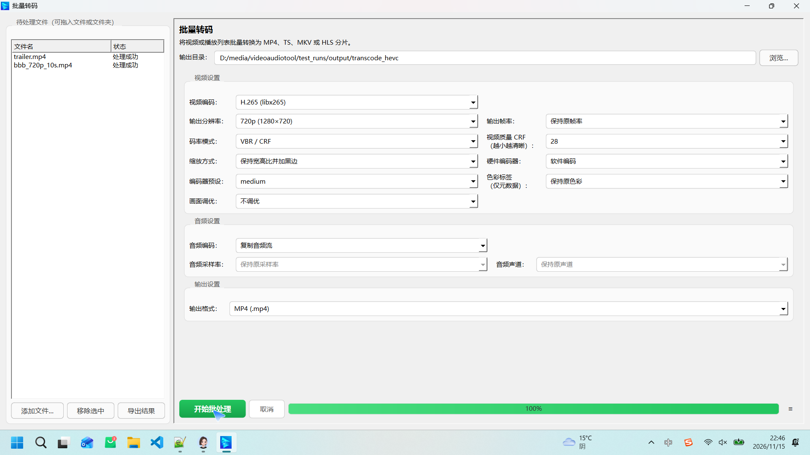
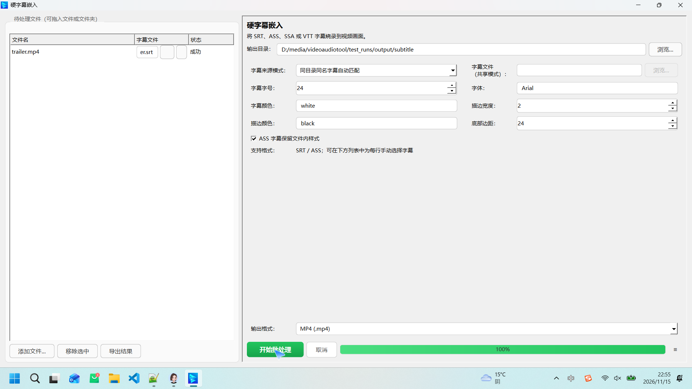
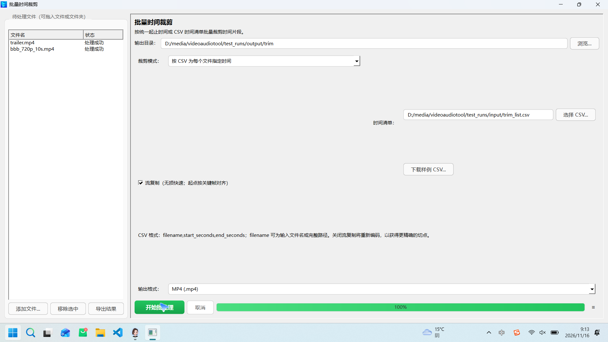
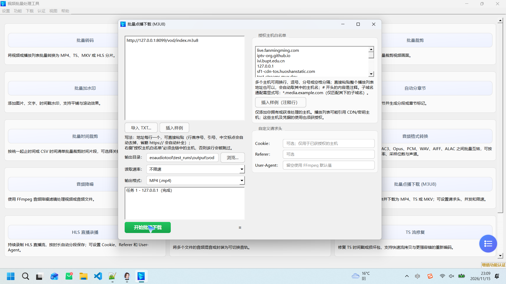
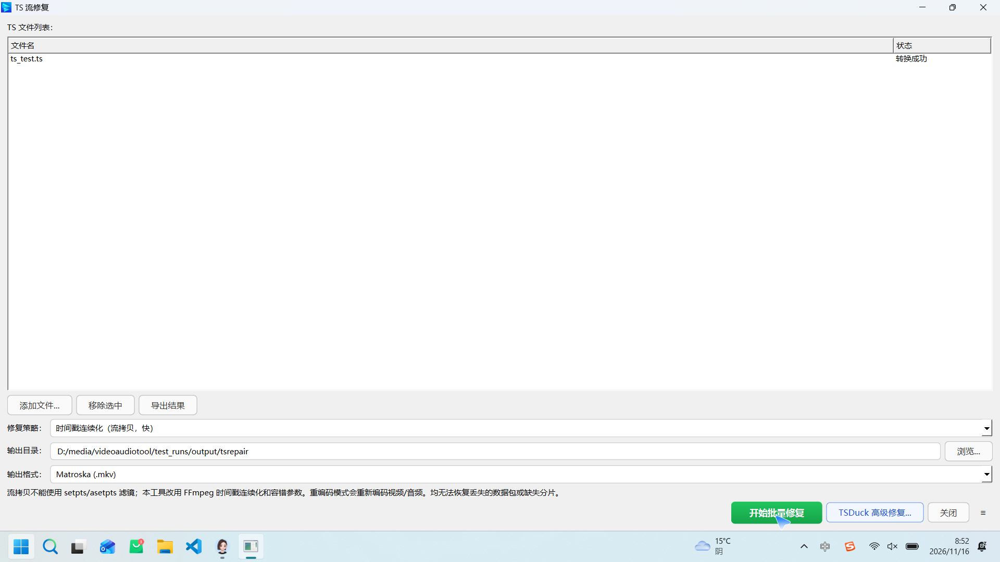

# VideoBatchTool — User Manual 

> Complete UI-only operating guide. No command-line content.

# 1 About This Manual

## 1.1 What It Covers

This manual is written for people who work through the interface. From opening the program for the first time, through batch transcoding, watermarking, burning subtitles, downloading streams, repairing damaged TS files, chaining steps into a pipeline and scheduling recurring jobs, everything is described as where to click, what to type and what you should see when it worked. No command-line content appears anywhere in these pages.

When you need to know which FFmpeg or TSDuck operation sits behind a particular switch, open the companion volume, User Manual — Technical Edition. Both manuals share the same feature split, the same tier boundaries and the same naming rules, so they can be read side by side.

The screenshots were captured from this build running on a real machine. The file names in the examples come from the test material; substitute your own.

## 1.2 Conventions

Paths through the menus are written as Menu → Item, for example Settings → Program Settings. Positional descriptions such as right pane or lower-left corner refer to the default window layout. A greyed-out control means the current combination of settings makes that option inapplicable.

Two markers follow feature and switch names: ★ means a Standard licence or above is required, ◆ means Value licence or above. Anything unmarked is a free feature that works even on an unactivated installation.

## 1.3 Ten Minutes to Your First Batch

Start with the simplest possible job, a container change, to walk the whole path from files in to results out.

1. Double-click VideoBatchTool.exe. If a message says FFmpeg cannot be found, go to Settings → Program Settings, point the FFmpeg directory at the folder containing ffmpeg.exe, save, and restart.
2. Click the light-blue title row of the Batch Transcode card on the home screen, or use Function → Batch Transcode. Maximise the window once it opens: at the default size the buttons along the bottom can be cut off.
3. Click Add Files, then paste the full path of your source file into the file-name field of the dialog, press Enter. Several files can be given at once, separated by spaces and wrapped in double quotes as a whole.
4. Leave the parameters at their defaults: video codec and audio codec both set to copy, output format MP4. This combination only rewrites the container, so a clip of a minute or two finishes in a second or two.
5. Type an output directory into the Output Directory field. That directory is shared globally, so confirm it again whenever you switch features.
6. Click Start Batch. The status column moves from Waiting to Processing and then to Completed, and the progress bar runs to the end.
7. Check the files in the output directory: the name should be the original name plus the _transcoded suffix, the size should be close to the source, and the file should play normally.
8. Open View → Log Window to see the per-item records for this batch. The log survives closing the window and is still there next time you open it.

Once this works, the other eleven batch features follow exactly the same skeleton. Only the parameter page differs.

---

# 2 Installation and First Launch

## 2.1 Portable, Unzip and Run

The product ships as a portable package. Unzip it anywhere and run it; there is no installer and nothing is written to the registry. Keep the whole folder at a short path without spaces or non-ASCII characters, because a few edge cases fail when source paths grow very long.

Table 2.1 Files you need to recognise

| Item | Purpose | If missing |
| --- | --- | --- |
| VideoBatchTool.exe | The main program | Nothing runs |
| lib folder | Holds ffmpeg.exe; every conversion depends on it | FFmpeg-not-found prompt at every launch |
| tsduck folder | Holds tsp.exe, tscore.dll and the plugin DLLs | Only TS repair and CC repair become unavailable |
| N_m3u8DL-RE.exe | External downloader, used only when that engine is selected | Stream downloads fall back to the other two engines |
| Logs folder | Command audit log, created automatically | Nothing; ignore it |
| report folder | Per-run reports written by scheduled tasks | Created on the first scheduled run |

## 2.2 Three Optional Components

ffmpeg.exe is mandatory; the other two are needed only for specific features. The program checks them at the moment they are used, so a missing component never blocks unrelated work.

- TSDuck powers the light continuity-counter repair under TS Stream Repair and every step of TSDuck Advanced Repair. It must be a complete folder: tsp.exe, tscore.dll and tsplugin_continuity.dll all in the same place. Copying a lone tsp.exe will not work. Put it in the tsduck subfolder of the program directory; the program also checks the system install location and the system environment variable.
- N_m3u8DL-RE is used only when Stream Downloader is set to that engine under Settings → Program Settings. You must also point at its executable on the same page, otherwise downloads report it cannot be found.
- When a component is missing the program shows a guidance dialog. Use Open Download Page to fetch it from the official site, or Choose TSDuck Folder to point at the directory right there; the pending task resumes as soon as you confirm.

## 2.3 Program Settings

Settings → Program Settings is where the program is tuned to your machine. Changes apply on save; the interface language needs a restart.

Table 2.2 Program settings

| Group | Setting | What to enter | Default |
| --- | --- | --- | --- |
| FFmpeg | FFmpeg directory | Folder containing ffmpeg.exe; empty means the program folder. A wrong folder is rejected on save | empty |
| TSDuck | TSDuck directory | Folder containing tsp.exe, tscore.dll and tsplugin_continuity.dll; empty triggers auto-discovery | empty |
| Interface | Follow system / English / Simplified Chinese | Follow system picks by the operating-system language and falls back to English | English |
| Streaming | Stream download engine | Native FFmpeg HLS (recommended); QtConcurrent segment fetching suits vod playlists; N_m3u8DL-RE needs its own path | Native |
|  | Segment download threads | 1 to 32; applies to segment-fetching engines only | 4 |
|  | Batch concurrent tasks | 1 to 16. Each file is a separate process, so 1 means one at a time | 4 |
|  | FFmpeg threads per task | 0 to 64; 0 is shown as Auto and lets the program decide | 0 (auto) |
| Advanced | Enable user-owned encrypted stream support | Covers standard HLS AES-128 only; ticking it confirms you hold the rights to that content | off |

Concurrent tasks multiplied by threads per task must not exceed the logical core count; when it does the interface highlights the field and disables OK. The rule matters: each file occupies a process of its own, so too many threads simply fight over cores and total throughput drops. A four-core machine is well served by 2 tasks at 2 threads, an eight-core machine by 4 tasks at 2 threads.

## 2.4 Activating a Licence

An unactivated copy still runs all nine free features, limited to five files per batch. To unlock Standard or Value features, use Authentication → SN Authentication.

1. Open the SN Authentication dialog. The Current Status block at the top shows the state, vendor, serial number, expiry, this machine and the instance ID; the last two can be selected and copied when you contact support.
2. Choose a channel under Authentication Channel. Automatic suits most cases; Official Site handles serials issued by the vendor site; LemonSqueezy handles licence keys issued from the merchant dashboard; Self-hosted Server covers an internal deployment.
3. Enter the serial or licence key. On the official channel the site address is read-only and derived by the program, so nothing to fill in; for self-hosted you enter the server address (for example http://192.168.1.10:8999/api/auth) and optionally the server public key.
4. Click Authenticate. While the online check runs the status block reports contacting the server; success shows the resulting tier, failure gives a reason.
5. Use Re-verify to confirm online immediately after an expiry or a machine change. Use Sign Out to clear local credentials, and on the LemonSqueezy channel Release Seat additionally returns the seat to the merchant dashboard.
6. Once activation succeeds the authentication indicator in the status bar updates and the locked cards on the home screen become clickable.

One caveat: after signing out, this build does not refresh the status text and badge until you reopen the dialog or restart. The actual permission is already updated.

---

# 3 Interface Overview

## 3.1 Main Window

The main window has four parts: the menu bar along the top (Settings, Function, Authentication, View, Help), the grid of feature cards in the middle, the status bar at the bottom, and the floating round button in the lower-right corner. The number on the button is the count of running tasks; click it to open the Task Center.

Cards are ordered free first, then Standard, then Value. Cards above your tier use locked styling but still open, and the guidance prompt appears when you do. Only the light-blue title row at the top of each card accepts clicks; clicking the descriptive text underneath usually does nothing.

## 3.2 The Seventeen Entries

Table 3.1 Home-screen entries

| Entry | Good for | Tier |
| --- | --- | --- |
| Batch Transcode | Shrinking size, changing resolution, switching container, HLS segments | Free |
| Batch Frame Extract | Stills for covers, visual review, building an index | Free |
| Batch Crop | Removing black bars, keeping a region, changing aspect | Free |
| Batch Watermark | Ownership marks, channel signatures, timestamped evidence | Free |
| Hard Subtitle Burn | Baking subtitles into the picture for platforms that reject sidecar files | Free |
| Audio Denoise | Removing hiss, air-conditioning hum, electrical noise | ★ |
| Loudness Normalise | Levelling sources recorded at different volumes | ★ |
| Track Merge | Joining clips, mixing several audio sources, multi-language muxing | ◆ |
| Auto Chapters | Splitting long recordings at pauses or fixed intervals | Free |
| Batch Time Trim | Uniform intros and outros, or per-file ranges from a list | Free |
| Batch Demux | Extracting raw video, audio and subtitle streams | Free |
| Audio Format Convert | Converting a soundtrack to one of nine formats | Free |
| Stream Download (M3U8) | Saving HLS vod content in bulk | ★ |
| HLS Live Recorder | Recording a live stream to local files, optionally segmented | ★ |
| TS Stream Repair | Fixing artefacts, stalling and files that will not open | ◆ |
| Pipeline (Pro) | Chaining several steps so output feeds the next step | ◆ |
| Scheduled Tasks | Processing new files in a folder on a repeating schedule | ◆ |

## 3.3 The Seven-Step Batch Workflow

All twelve batch windows share one layout: the pending-file list on the left (name and status, plus a subtitle or volume column in some features), the parameter page on the right, and the output directory and run buttons along the bottom. Every batch follows the same seven steps.

1. Open the window from the card title row or the Function menu, and maximise it first.
2. Click Add Files and paste full paths into the file-name field of the dialog, then press Enter; separate several paths with spaces and wrap the set in quotes.
3. Set parameters on the right. Prefer the keyboard for combo boxes: open the list, move with the arrow keys, confirm with Enter. Mouse selection occasionally fails to register.
4. Fill in the output directory. This is a long-lived global setting that carries over from the previous window, so confirm it in every feature.
5. Click Start Batch. The status column goes Waiting, Processing, then Completed or Failed, and the progress bar advances per file.
6. While running you can click Cancel to terminate the working process, or New Task to push this batch into the background and clear the list so the next batch can be configured immediately.
7. Judge the result by the files in the output directory, not by the status column alone: on a repeated run the column can still show the previous run's Completed.

## 3.4 Adding Files and Supported Formats

You can select several files at once, and you can force any file in through the All Files filter. The same path is never listed twice; repeats are ignored. Accepted extensions are mp4, mkv, mov, avi, wmv, flv, webm, m4v, ts, m2ts, mts, mp3, wav, flac, m4a, aac, ogg, opus, m3u8 and mpd.

Remove Selected deletes the highlighted rows. Export Results writes the current list and its statuses to a CSV in the output directory, encoded so that Excel opens it without garbled text. Demux, TS repair, TSDuck advanced repair and the Task Center each have an export of their own; the file names differ but the behaviour is identical.

## 3.5 Checks That Stop a Batch

Clicking Start Batch first runs a validation pass. Any single hit below stops the batch and names the reason. Fix what the dialog says rather than retrying.

- No files added, or the output directory is empty or does not exist.
- ffmpeg.exe cannot be found, or the material contains a zero-byte stub (the dialog names the file).
- A playlist (m3u8 or mpd) was added to any feature other than Batch Transcode; playlists are handled there only.
- HLS segment output was chosen in any feature other than Batch Transcode.
- The batch exceeds five files while unactivated; the program offers activation first and does not start if declined.
- Parameters are invalid: all four crop edges set to zero, a missing or empty watermark image, an unbound subtitle row, a spreadsheet that does not cover every input file.

## 3.6 Output Naming

Every feature appends its own suffix to the source's base name, so the provenance of any output is obvious. If a batch contains identical names from different directories, an eight-character discriminator is appended to the base name so nothing is overwritten.

Table 3.2 Output names by feature

| Feature | Output name | Notes |
| --- | --- | --- |
| Transcode / Crop / Watermark / Subtitle / Denoise / Normalise / Trim | base_transcoded, _cropped, _watermarked, _subtitled, _denoised, _normalized, _trimmed | Extension follows the chosen format |
| Frame Extract | folder base_frames holding images numbered from base_000001 | Keyframe, scene and thumbnail modes add _key, _scene or _thumb prefixes |
| Demux | base_video.h264, _audio.aac, _subtitle.srt | Second and later streams of a kind get 2, 3 and so on |
| Audio Format Convert | base_audio.mp3, .m4a, .flac and so on | Extension is the chosen format |
| Auto Chapters | base_chapter_001 upwards; metadata mode produces base_chapters | The split index is base_chapters.csv |
| Track Merge | concatenated, mixed_tracks, separate_tracks | One fixed name per merge mode |
| TS Repair | base_repaired.mkv, .ts, .mp4 | Repeats become _repaired_2, _repaired_3 |
| TSDuck Advanced Repair | base_tsduck.ts; merge mode yields merged_tsduck.ts | Output is always TS |
| Stream Download | hls_001_xxxxxxxx.mp4 | Three-digit sequence plus eight characters, extension per container |

An existing file of the same name is overwritten and only the log records it. To keep results from different batches apart, use a different output directory each time.

## 3.7 The Log Window

Logging is no longer embedded in each feature window. It lives in a separate window opened from View → Log Window, and every feature writes there, including download URLs and request headers, with sensitive values masked.

- View → Dock Left or Dock Right attaches the log beside the main window or the active child window, so it follows moves and resizes; when the followed window changes, the log column moves with it.
- Dragging the log window away, or choosing View → Undock, returns it to a free-standing window and each window behaves independently.
- The log window is modeless: parameter edits and button clicks work normally while a task runs, so nothing is blocked.
- Right-click to copy, select all, or clear. Clearing also discards the backing buffer, so the old lines do not reappear next time.
- Docking is not possible while the main window is maximised; the program restores the main window to its normal size first, then docks.
- Only the most recent 5000 lines are retained. Closing the window hides it; logging continues in the background.

For a complete command-level record, the Logs folder in the program directory holds the dedicated audit log, where every entry carries a timestamp, a sequence number and a result, which is what support will ask for.

---

# 4 The Twelve Batch Features

This chapter walks through the twelve batch features in home-screen order. Each section follows the same shape: when the feature is the right tool, then the steps and parameters, then how to tell the output is correct, and finally the pitfalls worth knowing.

## 4.1 Batch Transcode

The most-used feature. Two distinct uses: a format or container change that finishes in seconds, where both codecs stay on copy; or a real conversion that shrinks size, resizes or unifies codecs, where you pick an encoder and tune quality.

1. Maximise the window, then add files.
2. Choose the video codec. Copy Video Stream performs a lossless container change; resolution, scaling, frame rate and tuning all grey out at once, because a copy never passes through a decoder.
3. Choose the audio codec. Copy Audio Stream is the default; select AAC with a bitrate when audio needs unifying.
4. To change the picture, set the resolution and the scaling mode. Padding keeps the whole frame, cropping trims the edges, stretching distorts it.
5. Choose the rate-control mode. Quality mode is the default and one number decides sharpness; switch to fixed bitrate only when you need a predictable size.
6. Choose the output format: MP4, MPEG-TS or Matroska. For HLS distribution select HLS Segments and set the segment duration.
7. Fill in the output directory and start.

Table 4.1 Batch Transcode parameters

| Parameter | Range | Default | Recommendation |
| --- | --- | --- | --- |
| Video codec | H.264 / H.265 / VP8 / VP9 / AV1 / Copy video stream | Copy | Copy for a container change; H.264 or H.265 to shrink |
| Audio codec | AAC / MP3 / Opus / AC3 / Copy audio stream | Copy | AAC 192 for consistent delivery |
| Output resolution | Original / 2160p / 1080p / 720p / 480p / 360p / Custom | Original | 720p or 1080p for online distribution |
| Scaling mode | Pad / Crop / Stretch | Pad | Pad unless a full-frame result is required |
| Rate control | Quality / Fixed bitrate | Quality | Start with quality, switch to bitrate to hit a size |
| Quality value | H.264 0-51, H.265 0-51, AV1 0-63, per encoder | H.264 23; H.265 28; AV1 28 | Lower is sharper; 22 to 24 is the sweet spot for H.264 |
| Target bitrate | 100 to 100000 kbps, fixed-bitrate mode only | 4000 | 4000 to 6000 at 1080p, 2000 to 3000 at 720p |
| Encoder preset | ultrafast to placebo for x264/x265; 0 to 8 for VP8/VP9; 0 to 11 for AV1 | medium | medium for routine batches, veryfast when time matters |
| Hardware encoder ◆ | Software / NVIDIA NVENC / AMD AMF / Intel QSV | Software | Use when the GPU supports it: several times faster, slightly larger files at equal quality |
| Output frame rate | Source / 24 / 25 / 30 / 60 | Source | Leave alone; changing it rewrites timing |
| Colour tag | Keep / BT.709 / BT.601 | Keep | Metadata only, pixels untouched |
| Output format | MP4 / MPEG-TS / Matroska / HLS segments | MP4 | MP4 for web, TS for broadcast environments |

Checking the result: the size drops clearly while the duration stays the same; playback starts on the first frame, because the index was moved to the front; seeking does not stall. With stream copy the output should be almost exactly the size of the source.

Notes: every file in a batch shares one target resolution and quality value, so heterogeneous material is unified to one specification; a hardware encoder fails immediately when the driver is incomplete or the GPU does not support that codec, in which case switch back to software; HLS output exists only in this feature and produces a playlist plus a run of segment files that must be copied as a whole folder.

Figure 4.1 Batch Transcode finished, status column showing Completed

## 4.2 Batch Frame Extract

Splits a video into stills. Nine modes cover everything from one frame per second to every frame in the file; the most useful in practice are fixed interval and keyframes only.

1. Add the video files.
2. Choose a mode. Fixed interval is the general-purpose one; first or last frame suits cover art; keyframes only is fastest; scene change finds cut points; smart thumbnails pick the clearest frame inside each interval.
3. Fill in the value the mode needs: seconds for interval mode, a count for the frame-interval and uniform-count modes, a threshold for scene mode, an interval length for thumbnail mode.
4. Choose the image format and quality. PNG preserves detail, JPG saves space.
5. Tick Resize when smaller stills are wanted and set the target resolution; tick Overlay Watermark to stamp the image configured in Batch Watermark.
6. Fill in the output directory and start. Images land in a subfolder named after the source file.

Table 4.2 Frame Extract parameters

| Parameter | Range | Default | Recommendation |
| --- | --- | --- | --- |
| Extraction mode | Time interval / Frame interval / Uniform count / First frame / Last frame / Keyframes / Scene change / Smart thumbnail / All frames | Time interval | Interval for browsing, scene change for cut detection |
| Interval | 0.05 to 3600 s | 1.00 | 5 to 10 s when picking cover candidates |
| Count or frame step | 1 to 10000 | 20 | 60 stills gives one per second for a one-minute clip |
| Scene threshold | 0.01 to 1.00, higher is stricter | 0.30 | Lower it when too few cuts are found, raise it when too many |
| Thumbnail interval | 1 to 600 s | 10.0 | 20 to 30 s for indexing a long recording |
| Format / quality | PNG / JPG / WebP; 1 to 100 | PNG / 90 | For PNG the quality value acts as compression level, higher is smaller |
| Resize | Original / Specific resolution | Original | 1280x720 for web previews |

Checking the result: the number of images roughly equals duration divided by interval, and each image opens cleanly.

Notes: All frames asks for confirmation, because the count is roughly duration times frame rate and a long clip can produce tens of thousands of files; a batch never starts when the watermark overlay is ticked but the watermark image is invalid; leave enough free space in the output directory.

## 4.3 Batch Crop

Removes unwanted edges. The manual mode works in exact pixels; the automatic mode (◆) detects black bars first and crops accordingly, which is the practical choice for letterboxed film material.

1. Add the files and choose the crop mode.
2. In manual mode enter how many pixels to remove from the top, bottom, left and right. At least one edge must be greater than zero.
3. In automatic mode just start; the program analyses the frame for black bars and applies the result.
4. Fill in the output directory and start.

Table 4.3 Batch Crop parameters

| Parameter | Range | Default | Notes |
| --- | --- | --- | --- |
| Crop mode | Manual pixels / Auto-detect black bars ◆ | Manual | Prefer automatic on letterboxed material |
| Top, bottom, left, right | 0 to 16384 | 0 | Measured from the top-left corner; exceeding the frame causes an error |
| Output format | MP4 / MPEG-TS / Matroska | MP4 | Cropping always re-encodes; stream copy is impossible |

Checking the result: the bars are gone, the subject is intact, and both dimensions are even numbers, since odd dimensions fail.

Notes: you cannot crop away more than the frame contains; one set of values is shared across the whole batch, so mixed source sizes give inconsistent results and are better handled in groups; on material that never had black bars the automatic mode returns a near-original frame, which is correct behaviour.

## 4.4 Batch Watermark

Adds an image, text or timestamp to the picture. Seven types can be used alone or combined; combined watermarks, full-frame tiling and scrolling motion are the Value items.

1. Add files and choose the watermark type. An image watermark made from a transparent PNG is the most robust choice.
2. For image types use the browse button beside Watermark Image to pick the file; for text types fill in the text.
3. Set the watermark width as a percentage of the video width, the opacity, and the position. Combined types give each element its own position field.
4. Text and timestamp types also need a font, size, colour and outline width. Text is drawn on a translucent dark plate, which keeps it readable on light footage.
5. Fill in the output directory and start.

Table 4.4 Batch Watermark parameters

| Parameter | Range | Default | Recommendation |
| --- | --- | --- | --- |
| Watermark type | Image / Text / Timestamp, plus three two-item and one three-item combination | Image | Image alone handles most anti-reupload needs |
| Watermark width | 5 to 100 percent of video width | 25% | 15 to 25% for a small corner mark |
| Text / font / size | Free text; a font file; 8 to 200 pt | empty / Arial / 36 | Arial or a bundled CJK font is safest |
| Opacity | 0.00 to 1.00 | 1.00 | 0.6 to 0.8 for a subtle mark |
| Colour / outline | Colour name or #RRGGBB; 0 to 20 | white / 2 | Dark text with a light outline on pale footage |
| Position | Bottom right / bottom left / top right / top left / centre / bottom centre / top centre / full-frame tile ◆ / scrolling ◆ | Bottom right for image and text; bottom centre for timestamp | Bottom right for a plain signature |
| Scroll speed / tile spacing | 10 to 1000 px per second; 0 to 500 | 100 / 24 | Applies only to the matching position |

Checking the result: the mark scales proportionally with the video resolution, sits a fixed distance from the edge, and matches the opacity you set.

Notes: the timestamp is taken from the machine clock when each file starts, so parallel runs legitimately differ per file; an empty or unreadable image path, empty text, an unrecognisable colour or an unreadable font file all block the start; one watermark image can be used across different resolutions because the width is a percentage.

## 4.5 Hard Subtitle Burn

Renders subtitles into the picture. Use it when a platform rejects sidecar subtitle files, or when you want the text to be inseparable from the video. Burning always re-encodes, so it is slower than transcoding.

1. Add the video files. The second column of the list shows the subtitle match for each row.
2. Choose the subtitle source mode. Same-name auto match is the least work; one subtitle for all videos suits a common intro; same-name per video suits subtitles stored elsewhere; per-file binding is the most flexible but every row must be bound.
3. For auto matching make sure an identically named .srt or .ass sits beside the video. Subtitles may also be placed in the output directory, which the program checks first.
4. Set size, font, colour, outline and bottom margin. When the subtitle file carries its own styling, tick Keep ASS Styles From File (◆) so the file's styling survives.
5. Fill in the output directory and start.

Table 4.5 Hard subtitle parameters

| Parameter | Range | Default | Recommendation |
| --- | --- | --- | --- |
| Subtitle source | Same-name auto match / One for all / Same-name per video / Per-file binding | Same-name auto | The first mode for bulk material |
| Size / font | 8 to 72 / font name | 24 / Arial | 24 to 28 at 1080p |
| Colour / outline colour | Colour name or hex | white / black | Keep contrast high |
| Outline width / bottom margin | 0 to 10 / 0 to 500 | 2 / 24 | Outlines help on pale footage |
| Keep ASS styles ◆ | On / off | On | Tick when the file has its own effects, otherwise interface values overwrite it |

Checking the result: subtitles appear burned into the frame at the configured size and position, and stay visible after seeking.

Notes: only SRT and ASS are accepted; in per-file mode an unbound row prevents the start; a file whose same-name subtitle is missing is marked failed on its own row without affecting the others; a row where you manually chose a subtitle is never overwritten by auto matching.

Figure 4.2 Task list after hard subtitle burn

## 4.6 Audio Denoise ★

For recordings with a noise floor: air conditioning, electrical hum, wind. Two algorithms: Afftdn exposes controllable parameters, Anlmdn suits steady continuous noise.

1. Add files; video files can be added directly, since only the audio is processed.
2. Choose the algorithm and strength. The default strength is 0.30; run a short piece with defaults and listen first.
3. Tick Track Noise Floor Automatically when the noise level drifts, and Keep High-Frequency Detail to preserve sibilance and breath.
4. Choose the output format and directory, then start.

Table 4.6 Audio denoise parameters

| Parameter | Range | Default | Recommendation |
| --- | --- | --- | --- |
| Algorithm | Afftdn / Anlmdn | Afftdn | Afftdn for clearly steady noise |
| Strength | 0.00 to 1.00 | 0.30 | Start at 0.3; drop to 0.2 if speech turns dull |
| Track noise floor | On / off, Afftdn only | Off | On when the noise floor drifts |
| Keep high-frequency detail | On / off, Afftdn only | On | Keep on for voice material |

Checking the result: background noise is clearly reduced, voices are not thinned, and the duration is unchanged.

Notes: the picture is never re-encoded, so speed depends on audio length only; excessive strength makes voices hollow and adds an underwater quality, so two gentle passes beat one aggressive pass.

## 4.7 Loudness Normalise ★

Brings audio from different sources to one loudness level. Do this before assembling a batch so listeners do not reach for the volume control between segments.

1. Add files and choose the scheme.
2. For loudness normalisation enter the target, or click a common target (online video, podcast, broadcast) to fill it in.
3. Enter the true peak. -1.0 is usual; -2.0 is the conservative choice.
4. For higher precision tick Two-Pass Accurate Normalisation (◆): the whole file is measured first, then adjusted uniformly.
5. Choose the output format and directory, then start.

Table 4.7 Loudness parameters

| Parameter | Range | Default | Recommendation |
| --- | --- | --- | --- |
| Scheme | Loudness normalise / Peak limit | Loudness | Loudness for platform delivery |
| Target loudness | -30.0 to -5.0 | -16.0 | -14 online video, -16 podcast, -23 broadcast |
| True peak | -9.0 to 0.0 | -1.0 | Keep between -1.0 and -2.0 |
| Two-pass ◆ | On / off, loudness mode only | Off | Turn on for quality-critical work; roughly doubles the time |

Checking the result: outputs from different sources now sit at similar loudness, with no clipping artefacts.

Notes: in peak mode the target, the common targets and two-pass all grey out, which is expected linkage; this build's single-pass output can raise the audio sample rate to 96 kHz, so follow with an audio format conversion to 48 kHz if downstream requires it; raising level also raises the noise floor, so denoise before normalising.

## 4.8 Track Merge ◆

Joins several pieces into one, mixes several audio sources into one, or muxes multiple switchable audio tracks. At least two inputs are required.

1. Add two or more files, arranged in the order you want them to appear.
2. Choose the merge mode: sequential concatenation, audio mix, or multi-track mux.
3. In mix mode set the fade in and out duration and adjust each source's level with the slider in the second column.
4. Choose the channel layout and output format, fill in the directory, then start. The whole batch runs as a single task.

Table 4.8 Track merge parameters

| Parameter | Range | Default | Notes |
| --- | --- | --- | --- |
| Merge mode | Concatenate / Mix to one track / Multiple switchable tracks | Concatenate | Concatenate for a finished cut, mix for interviews, multi-track for languages |
| Fade in / out | 0.0 to 30.0 s | 0.0 | Mix mode only |
| Channel layout | Stereo / Mono / 5.1 | Stereo | Keep consistent when mixing sources |
| Per-file level | 0 to 100% | 100% | Mix mode only |

Checking the result: a concatenation lasts about the sum of the parts; a mix lasts as long as the longest source; a multi-track file lets the player switch tracks.

Notes: concatenation normalises everything to 1280x720 and 48 kHz stereo, so large material is downsampled; transcode those separately first if the original picture must survive. When muxing tracks the title comes from the file name, so rename duplicates beforehand. The batch counts as one task, so the progress bar advances in one or two steps.

## 4.9 Auto Chapters

Either splits a long video into parts or writes chapter information into the file. Pause-based splitting is the usual choice for recorded lectures, interviews and podcast video.

1. Add files and choose the output style.
2. For silence-based splitting set the threshold and the minimum silence; for fixed splitting set the interval in minutes; for marker-based splitting prepare the time list first.
3. Keep Generate Chapter CSV Index ticked when a manifest is wanted.
4. Tick Re-encode When Splitting for exact cut points; leave it unticked for speed, in which case cuts snap to the nearest keyframe.
5. Choose the output format and directory, then start.

Table 4.9 Auto Chapters parameters

| Parameter | Range | Default | Recommendation |
| --- | --- | --- | --- |
| Output style | Silence split / Fixed interval / Marker file / MKV with chapter marks | Silence split | Silence split for speech with pauses |
| Split interval | 0.5 to 1440 min | 15.0 | Fixed-interval mode only |
| Marker file | txt / csv / srt | empty | Times accept hours-minutes-seconds or plain seconds |
| Silence threshold / minimum silence | -80 to -10 dB; 0.2 to 30 s | -35.0 dB / 1.5 s | Relax to -45 dB when music plays continuously |
| Generate chapter CSV index | On / off | On | Keep on when a manifest is needed |
| Re-encode when splitting | On / off | Off | Tick when cut accuracy matters |

Checking the result: the number of parts matches expectations and each part plays independently from the start.

Notes: silence splitting and chapter metadata need material that carries an audio track; MKV-with-chapters is refused when the output format is TS; cutting points closer than 0.5 s cause the later one to be ignored; in this build ticking the CSV index can produce no file, and splitting itself is unaffected, so assemble the manifest manually if it is missing.

Figure 4.3 Per-file trimming from a list, both files processed over their own ranges

## 4.10 Batch Time Trim

Cuts segments by time. A uniform range suits a shared intro; CSV mode gives every file its own range.

1. Add files and choose the mode.
2. In uniform mode enter the start and end in seconds with three decimals.
3. In CSV mode click Download Sample CSV for the template, fill in file name, start and end, then import it.
4. Decide on Stream Copy (fast and lossless). Ticking it makes the start snap to the nearest keyframe, which can shift by a few tenths of a second; unticking re-encodes for an exact cut.
5. Fill in the output directory and start.

Table 4.10 Batch Time Trim parameters

| Parameter | Range | Default | Notes |
| --- | --- | --- | --- |
| Mode | Uniform range / Per-file ranges from CSV | Uniform | Use CSV for different ranges per file |
| Start / end | 0 to 604800 s, three decimals | 0 / 60 | The end must be later than the start |
| Time list CSV | Required in CSV mode | empty | Columns: file name, start, end |
| Stream copy | On / off | On | Untick when accuracy matters |

Checking the result: the duration approximates the requested range and the first frame is close to the intended point, allowing a few hundred milliseconds with stream copy.

Notes: the CSV may identify files by name, base name or full path, but a name that matches several inputs must be replaced by the full path; a CSV that does not cover a given input reports a missing entry; a repeated input is an error; outputs grow larger when re-encoding.

## 4.11 Batch Demux

Splits the video, audio and subtitle streams out in their original compressed form, with no re-encoding, which is what you want when another tool will take over the material.

1. Add files and choose the demux mode.
2. Fill in the output directory and start. The program inspects the stream layout first, then exports each stream.

Table 4.11 Batch Demux parameters

| Parameter | Range | Default | Notes |
| --- | --- | --- | --- |
| Mode | Video only / Audio only / Subtitles only / Video plus audio / All streams | Video only | All streams when the contents are unknown |
| Output format | Follows the original compressed format | Auto | Video is usually h264 or hevc, audio aac or ac3 |

Checking the result: extensions match the stream formats and each file opens in the corresponding analysis tool.

Notes: a selected stream that does not exist reports that no target stream was found; in combined modes a missing stream type is only logged, not failed; cover art is ignored; nothing is re-encoded, so speed tracks your disks.

## 4.12 Audio Format Convert

Converts a soundtrack to one of nine audio formats. Video files can be added directly and the audio track is extracted.

1. Add files and choose the output format.
2. For lossy formats choose rate control: quality or fixed bitrate. Lossless formats hide the bitrate field.
3. In MP3 quality mode set the quality level; for FLAC set the compression level.
4. Set the sample rate and channel count when the output must be uniform; otherwise leave them as they are.
5. Fill in the output directory and start.

Table 4.12 Audio format parameters

| Parameter | Range | Default | Recommendation |
| --- | --- | --- | --- |
| Output format | MP3 / AAC / AAC raw / FLAC / AC3 / Opus / ALAC / WAV / AIFF | MP3 | MP3 or AAC for delivery, FLAC for archiving |
| Rate control | Quality / Fixed bitrate, lossy formats only | Quality | Fixed bitrate for uniform delivery |
| Target bitrate | 32 to 640 kbps | 192 | 128 for speech, 192 to 256 for music |
| Quality or level | MP3 0 to 9 (0 is best); FLAC 0 to 8 (8 is strongest and slowest) | 4 | 2 to 4 for MP3, 5 for FLAC |
| Sample rate / channels | Keep / 22050 / 32000 / 44100 / 48000 / 96000; Keep / mono / stereo | Keep | Speech material can go mono to save space |

Checking the result: the output opens in a player and lasts as long as the source track; lossless files are clearly larger.

Notes: only the first audio track is taken and the rest of a multi-track file is discarded; APE is input-only, so its absence from the output list is deliberate; a source without any audio track fails.

---

# 5 Streaming Tools

The two streaming entries share one set of settings: the authorised host whitelist, the concurrency limit and the custom request headers. Change them in one place and both follow. Confirm you have the right to handle the content before you start; the tool does not bypass any DRM or access control.

## 5.1 Stream Download ★

The window is split into two panes: addresses and output settings on the left, shared configuration and request headers on the right.

Table 5.1 Left pane controls

| Control | How to use it |
| --- | --- |
| Address box | One playlist URL per line; lines starting with # are comments. Pasting works directly: leading numbering, quotes and trailing remarks are stripped automatically |
| Import TXT | Appends addresses from a text file, useful for prepared lists |
| Insert Sample | Inserts a commented example so the format is obvious; nothing is downloaded |
| Output directory | Defaults to the Downloads folder on first use, then shared with the other windows |
| Read rate | Unlimited, real time, half speed, quarter speed; native engine only |
| Output format | MP4 / MPEG-TS / Matroska |
| Queue | Per-line status: waiting, inspecting playlist, downloading, succeeded or failed |
| Start Batch Download / New Task | The latter does not cancel running downloads, it only clears the inputs and the queue display |

The right pane holds the authorised host whitelist (host names only, separated by newlines, commas or spaces, subdomain wildcards written as an asterisk plus the domain), the maximum concurrent tasks (1 to 8, default 2), and the custom request headers (Cookie, Referer, User-Agent). Headers are a Value switch and can be tried three times when unlicensed.

1. Paste one playlist address per line into the address box.
2. Add the hosts of those addresses to the whitelist. A host that is not whitelisted triggers a prompt; confirming adds it in one click, declining skips that line.
3. For sites with hotlink protection, supply Referer and User-Agent; supply Cookie when a login state is needed. Values must not contain line breaks.
4. Set concurrency, read rate and output format. If the output file already exists you are asked whether to overwrite.
5. Click Start Batch Download and watch each line in the queue.

Checking the result: outputs are named like hls_001_xxxxxxxx.mp4 and play from start to finish; every queued line ends with a definite outcome, and skips or failures state the reason.

Notes: the whitelist is a compliance constraint, not a security measure, so only add hosts you are entitled to handle; high concurrency gets rate-limited by the CDN and ends up slower; encrypted playlists need a key, and only standard AES-128 is supported, after the option is switched on in settings; empty files with an extension that does not match the actual content can be left over from older builds and are safe to delete, as this build fixes that.

Figure 5.1 Stream Download finished, with the log and task status

## 5.2 HLS Live Recorder ★

Records a live stream to local files continuously, optionally segmented by the hour. Closing the window only hides it; recording continues in the background.

Table 5.2 Live recorder parameters

| Control | Meaning | Default |
| --- | --- | --- |
| Live playlist address | http or https; the apparent extension is only a hint and the playlist content decides | empty |
| Recording variant | Which rendition of a multi-bitrate master to record, listed from highest bandwidth down | Auto (highest bandwidth) |
| Output format | MP4 / MPEG-TS / Matroska; switching it also changes the recording file extension | MP4 |
| Recording duration limit | 0 to 168 hours; 0 means record until stopped manually | 0 |
| Segmentation | When ticked, split every N minutes with date and time in the segment name | ticked, 60 minutes |
| Recording file | Output path; the directory must already exist and the extension must match the format | default name on first use |

1. Enter the live address. When the master playlist offers several bitrates, pick one under Recording Variant so only that rendition is recorded.
2. Choose the output format, set the duration limit and the segmentation settings.
3. Confirm the directory and the file name, then click Start Background Recording.
4. To finish, click Stop Recording; the program lets the process close out first and only forces an end after several seconds.
5. Closing the window leaves recording running; reopen the window or watch the Task Center to see the state again.

Checking the result: the recording grows steadily in size; in segmented mode files appear at the configured interval and each one plays on its own.

Notes: cut points follow keyframes, so actual segment lengths vary slightly; in this build the combination of a specific output directory with automatic segmentation can fail to produce any file because the process exits abnormally, so switch segmentation off first when it happens; long recordings need continuous free space, so size the disk before you start.

## 5.3 Messages for Both Streaming Tools

Table 5.3 Streaming messages

| Message | Meaning | What to do |
| --- | --- | --- |
| Host not authorised | The host is not on the whitelist | Accept the one-click prompt, or add it in the right pane |
| Invalid request header | A cookie or user agent contains a line break, or the referer is not a valid address | Remove line breaks, complete the referer with http or https |
| Concurrency limit reached | The configured maximum is in use | Wait for a task to finish, or raise the limit |
| N_m3u8DL-RE not found | The external engine is selected but no executable is configured | Set the path in program settings, or switch back to the native engine |
| Encrypted playlist | The playlist declares AES-128 but support is not enabled | Confirm rights, then enable encrypted stream support in program settings |
| Download interrupted | CDN fluctuation or rate limiting | Lower concurrency, switch to half-speed reading, retry |

---

# 6 TS Stream Repair

TS is the container used by broadcast and live delivery. Typical symptoms of damage are blockiness, mosaic artefacts, stalling, audio and video drifting apart, a duration that reports zero, or a file that will not open at all. Repair makes existing data usable again; data already lost cannot be recreated.

## 6.1 Diagnose First, Then Choose a Strategy

Table 6.1 Symptoms and strategy

| Symptom | Likely cause | Suggested strategy |
| --- | --- | --- |
| Plays, but the duration is wrong, the start jumps, or audio drifts | Timestamp jumps or negative timestamps | Timestamp continuity, fastest and lossless |
| Local blockiness and mosaic, otherwise playable | Transport error packets and gaps | Drop damaged packets and remux |
| Assembled from segments, stalls periodically | Continuity counter gaps | TSDuck light CC repair |
| Structure badly scrambled, PSI/SI tables damaged, never opens | Widespread table and counter damage | Fault-tolerant re-encode, or TSDuck advanced repair |
| Truncated tail, junk bytes at the head | Incomplete file | Head alignment and tail truncation in advanced repair |

## 6.2 Operating the Four Strategies

The dialog works in batch: the TS file list on the left, strategy and output format on the right, output directory and start button along the bottom. It accepts ts, m2ts and mts files, and never adds the same file twice.

1. Click Add Files to load the damaged TS files.
2. Choose a strategy. When unsure, start with the first: fastest and lowest risk.
3. Choose the output format. Matroska is the default because it tolerates timestamps best; the TSDuck light repair forces TS.
4. Fill in the output directory. Output and input may not be the same file; the program refuses that.
5. Click Start. The list and the parameters lock while it runs; Cancel Repair stops it.

Table 6.2 The four strategies compared

| Strategy | Suits | Output | Cost |
| --- | --- | --- | --- |
| Timestamp continuity (stream copy) | Timestamp jumps, negative timestamps | MP4 / TS / MKV | Seconds to finish, pixels untouched, but no data is recovered |
| Drop damaged packets and remux | Material with clear bad packets | MP4 / TS / MKV | Bad packets are discarded, brief stalls possible |
| TSDuck light CC repair | Gaps introduced by segment assembly | TS only | Counters and representative tables only, content untouched |
| Fault-tolerant re-encode | Heavy structural damage that still decodes | MP4 / TS / MKV | Slowest, slight quality loss, but the most reliable |

Checking the result: the file plays normally, the duration and track layout are right, and artefacts and stalls are clearly reduced. Output is named after the source with the _repaired suffix, plus a sequence number on repeats.

Notes: keep the original before repairing and never overwrite it repeatedly in the same folder; filtering every bad packet does drive the error count to zero, but frames go missing too, so judge by whether the file plays rather than by an empty error log; when TSDuck is missing the program shows guidance and resumes as soon as you pick the folder.

Figure 6.1 TS Stream Repair finished, list showing Completed

## 6.3 TSDuck Advanced Repair ◆

When the basic strategies are not enough, use the TSDuck Advanced Repair button at the bottom of the TS repair window. It is outlined in light blue rather than filled green, to separate it from the primary button, and it greys out while a basic repair is running. Files already in the list are carried over.

The window has four areas: the preset list, Apply Preset button and read-only TSDuck directory along the top; the step tree on the left, where every step can be ticked and the second column summarises its key parameters; the parameter panel for the selected step on the right, each step offering an Additional Arguments field for options the interface does not expose; the input list and file actions below that; and the output directory, overwrite policy, merge switch, keep-partial switch, concurrency and start button along the bottom.

1. Pick a preset and click Apply Preset to tick the steps for you, then adjust each one.
2. Or tick the steps you want in the tree and fill in their parameters on the right: PIDs, seconds, packet counts, bitrates, files.
3. Add the TS files to the list. Tick Merge Selected Files Into One Output when several pieces should become a single file.
4. Choose the overwrite policy: overwrite, skip if exists, or auto-rename. The latter two are safer whenever names repeat.
5. Fill in the output directory, set concurrency, and click Start Batch Repair.

Table 6.3 Step categories available in advanced repair

| Category | What it can do | When to use it |
| --- | --- | --- |
| Packet sync and damaged packets | Locate the packet boundary, drop invalid packets, drop a chosen stream, repair continuity counters, skip the head, extract a range, cut by time or packet count, truncate the tail, clean up structure | Will not open, blocky, trailing junk |
| Stream identity | Identify each stream, renumber, shift a whole range, remove orphan streams, remove a whole programme, copy a stream | PID collisions, several programmes in one file |
| Programme and description tables | Rebuild the programme table, delete programmes and streams, rename a service, change the programme number, change the TS identifier, inject programme information | Wrong service name shown, empty programme list |
| Timestamps and bitrate | Shift timestamps, correct the clock against a bitrate, copy clock references, regulate to constant bitrate, strip null packets to lower bitrate, insert null packets to raise it | Player freezes, bitrate swings |
| Merging and splicing | Merge several files, inject or remove advertisement identifiers | Joining pieces into one |
| Data injection | Inject programme tables or private data sections, extract data broadcast content | Filling in missing tables or extracting data |

Encryption and raw-stream packaging are deliberately absent from the interface: the first needs a commercial encryption chain, the second belongs in another tool. The interface only offers what it can actually do.

Table 6.4 The eight presets

| Preset | Steps included |
| --- | --- |
| Deep repair in one click | Auto align, drop invalid packets, repair continuity counters, clean up structure, truncate the tail |
| CC continuity only | Repair continuity counters |
| Packet clean-up | Drop invalid and padding packets, repair continuity counters |
| Head junk and tail truncation | Auto align, truncate the tail |
| Rebuild programme tables | Rebuild programme tables and the programme structure, refresh service names |
| Timestamp shift | Shift clock references and presentation timestamps |
| Regulate bitrate | Regulate output to a constant bitrate |
| Lower bitrate | Strip null packets to reduce bitrate |

Execution details: ticked steps always run in a safe order, aligning first, then filtering, counters, programme tables, stream identity, timestamps, and bitrate regulation last, regardless of the order you ticked them, so you never have to think about sequencing. Output is always TS. Each file is handled independently; a single failing step marks the file failed and deletes the partial output, unless Keep Partial Output On Failure is ticked for diagnosis.

Notes: merge mode needs at least two files; ticking both Skip Head and Extract Packet Range asks for confirmation once; when a step's component is missing the dialog lists every missing file, and retrying after supplying them is enough.

Legal note: streaming and bitstream features are for content you are entitled to access. Encrypted stream support covers standard HLS AES-128 only and involves no DRM circumvention of any kind.

---

# 7 Pipeline ◆

Chains several processing steps so the output of one becomes the input of the next. It suits a fixed production recipe: crop, denoise, normalise, burn subtitles, watermark, transcode, chapter-mark, extract stills, configured once and reused.

## 7.1 Local File Pipeline

1. Open the Pipeline window, switch to the Local File Pipeline tab, and set the output directory.
2. Add input files. Whether playlists are accepted depends on the first subtask; usually only Batch Transcode handles them.
3. Click Add Subtask, choose one of the twelve features, and configure it in the parameter dialog. Incomplete parameters are reported as such, and cancelling leaves that step out.
4. Reorder with Edit, Remove, Move Up and Move Down. Double-clicking a list entry also edits it.
5. Click Start Pipeline. Once validation passes the window closes and the whole chain continues in the Task Center as one task.

How files pass between stages is worth remembering separately: the program looks in the output directory for every product of the previous stage whose name starts with the original base name plus an underscore, and hands them all to the next stage. Single-output features therefore run one in, one out. Multi-output features, such as frame extraction, demux, track merge, chapter splitting and HLS-segment transcoding, turn one input into many files and the chain forks into parallel sub-chains at that point. Put those near the end to keep the fan-out manageable.

Execution runs stages in sequence and files within a stage in parallel up to the concurrency setting; a file that fails in one stage stops there; progress advances as input files multiplied by subtasks.

## 7.2 HLS Pipeline

The HLS tab folds acquisition into the chain: download vod content or record a stretch of live stream, optionally apply one fault-tolerant TS remux, then run the subtask chain.

Table 7.1 Source settings for the HLS pipeline

| Control | Meaning | Default |
| --- | --- | --- |
| Source type | Stream download / Live recording | Stream download |
| Recording duration | 1 to 86400 s, live only; must be greater than zero for the chain to advance automatically | 300 |
| Live address | Playlist or live URL; the host whitelist from the streaming tools applies | empty |
| TS repair | Runs one fault-tolerant remux after acquisition, appending the _repaired suffix | ticked |
| Request headers | Referer, User-Agent, Cookie; values containing line breaks are ignored | empty |
| Output directory | Shared with the other windows | user folder |

The subtask chain behaves as on the local tab, with two presets: a high-quality recipe that denoises and normalises before subtitles and the watermark, and a simple chain in the usual order. Both can be edited after loading.

Execution and naming: acquisition output carries the _source suffix and the repaired file the _repaired suffix; progress gives acquisition the first 30 percent and the chain the remaining 70; the whole pipeline appears as one task in the Task Center, with the source listed in the file column.

## 7.3 Things to Watch

All subtasks share the single output directory on the tab, and intermediate products stay there under each feature's own naming rules. Closing the main window while a pipeline runs terminates it; closing only the pipeline window does not cancel a task already started.

In this build, Time Trim used as a pipeline subtask does not pass its start and end through to the worker, so the product is a fraction of a second long. Work around it by trimming in the standalone window first and feeding the result to the pipeline, or by using a step that does not depend on time parameters, such as chapter splitting.

---

# 8 Scheduled Tasks ◆

A scheduled task scans one folder on a repeating cycle, processes newly arrived files automatically and files them away. It is the answer to the daily chore of transcoding whatever landed in a drop folder overnight.

## 8.1 Creating a Task

1. Open Scheduled Tasks from the home-screen card and give the task a name.
2. Set the Watch Folder, where incoming material lands, and the Converted Folder, where output goes. They may not be the same.
3. Set the first start time and the repeat interval. A first start earlier than now triggers one catch-up run immediately after saving.
4. Click Add Subtask, choose a processing step and configure it, exactly as in a pipeline.
5. Click Save. The task enters the schedule at once.

Table 8.1 Scheduled task fields

| Field | Meaning | Notes |
| --- | --- | --- |
| Task name | Identifier shown in the Task Center and in the reports | Duplicate names create separate tasks |
| Watch folder | Folder that is scanned | Successfully processed files move into its processed subfolder |
| Converted folder | Where output goes | Must differ from the watch folder |
| First start | Moment of the first run | A past time triggers an immediate catch-up run |
| Repeat interval | Cycle between scans | Measured in hours |
| Subtask chain | Steps and their parameters | Three steps at most when the tier is insufficient |

At the default size of the new-task dialog the Save and Cancel buttons along the bottom can be unresponsive. Maximise the window first, or move between buttons with the keyboard and press Space.

## 8.2 Run Records

Every trigger writes a numbered text report into the report folder in the program directory: task number and name, trigger time, subtask chain, both folders, processing statistics and the list of files processed. A run with no new files says so explicitly; an empty round is normal.

Three places answer any question about a scheduled task: the report says what the round did, the log window shows how it went, and the processed subfolder proves whether a file was moved away. When the tier is insufficient and the trials are used up, that round is skipped and rescheduled to the next cycle rather than retrying the same batch endlessly.

---

# 9 Task Center

The floating round button in the lower-right corner of the main window opens the Task Center; the number on it is the count of running tasks. Batch jobs, stream downloads, TS repairs and pipelines are all registered here.

## 9.1 Layout

The summary strip along the top reports how many tasks are running, how many are queued and how many history entries exist; unactivated copies add a note that tasks run one at a time. The four tabs are Current Tasks, History, Scheduled Tasks and Scheduled History.

Table 9.1 The nine columns

| Column | Content |
| --- | --- |
| Number / Feature / Operation | Task sequence, originating feature, and a one-line description |
| Files | The first three entries only; hover for the full paths |
| Status / Progress | Queued, running, succeeded, failed, cancelled. Hover the status for the failure or queue reason |
| Started / Finished / Duration | Hover the start time to see the output directory |

Colours separate the states clearly: queued is orange, running is blue and bold, succeeded green, failed red, cancelled grey. The progress and elapsed time of running tasks refresh every second.

## 9.2 Available Actions

- End Task: select a running task and confirm; its process is terminated immediately, and any partially written output may be incomplete.
- Cancel Queue: for a queued task the button becomes Cancel Queue; confirming marks it cancelled and it never starts.
- Clear History: available only on the History tab, and irreversible once confirmed.
- Edit / Terminate: only on the Scheduled Tasks tab. Edit keeps the processed records and recomputes the next run from the new time; Terminate stops future triggers while the current round finishes.
- Reuse: select a terminated definition in the Scheduled History tab and a new-task dialog opens carrying its name, folders, times, interval and the whole subtask chain; saving creates a new task while the old definition stays terminated.
- Export CSV: export when any tab has records; current and historical tasks are written to one file in the global output directory, which Excel opens directly.

Scheduling rules: unactivated copies run everything serially, one task at a time and one file at a time inside a task. Once activated, tasks whose files do not collide run in parallel; when two tasks touch the same input file the later one queues first and starts automatically after the earlier one ends. History keeps at most 200 entries within the last 7 days.

---

# 10 Licensing and Tiers

## 10.1 Four Tiers

Table 10.1 Tiers and capabilities

| Tier | What it unlocks | Limits |
| --- | --- | --- |
| Unactivated | All nine free features | Five files per batch; three trials per Standard and Value feature, within a 15-day trial window |
| ★ Standard | Adds Audio Denoise, Loudness Normalise, Stream Download, HLS Live Recorder | Value features and Value switches stay at three trials |
| ◆ Value | Adds Track Merge, TS Stream Repair, Pipeline, Scheduled Tasks and every sub-feature Value item | No limit on count or file size, apart from cluster scheduling |
| Enterprise | Adds distributed cluster scheduling on top of Value | None |

The nine free features are Batch Transcode, Batch Frame Extract, Batch Crop, Batch Watermark, Hard Subtitle Burn, Auto Chapters, Batch Time Trim, Batch Demux and Audio Format Convert.

## 10.2 Sub-Feature Value Switches

Some switches are counted separately: each may be tried three times when unlicensed, and declining the licence prompt rolls the control back to its previous value. They are the hardware encoder in Batch Transcode; auto black-bar detection in Batch Crop; full-frame tiling, scrolling motion and combined watermarks in Batch Watermark; Keep ASS Styles From File in subtitle burning; two-pass in Loudness Normalise; and custom request headers in the streaming tools.

## 10.3 How Trials Work

Trial counts are deducted when a task actually starts, not when a window is opened. The trial window is independent of tier and runs 15 days from the first launch. Trials are also subject to the five-file batch limit. Pipeline and scheduled tasks are counted separately, three runs each, and with an insufficient tier a chain is capped at three subtasks, so a fourth is refused.

## 10.4 The Three Authentication Channels

Table 10.2 How the channels differ

| Channel | Credential | When offline | On expiry |
| --- | --- | --- | --- |
| Official site | A vendor-issued range serial | The local licence keeps working | A dated serial drops to free features with a renewal prompt |
| LemonSqueezy | A licence key | The local licence keeps working | Keys carry no date, so nothing expires locally |
| Self-hosted server | A credential issued by the internal server | Reports an outage and disables Standard and Value after 24 hours | Decided entirely by the server |

One online re-check happens at launch and further checks follow at irregular intervals. Offline, the local licence stands; when the server states the serial is invalid the program signs out, drops the tier and tells you. After a machine change or reinstall the seat is occupied again, and when the quota is full use Release Seat to return the old machine's seat.

---

# 11 Troubleshooting and Known Issues

## 11.1 Message Reference

Table 11.1 Common messages and what to do

| Message | Cause | Action |
| --- | --- | --- |
| FFmpeg not found | Wrong component directory | Point program settings at the folder containing ffmpeg.exe |
| The following input files are empty (0 bytes) | Zero-byte stub left by an earlier failure | Remove or replace the file |
| Operation does not support playlist input | Playlists are accepted only by Batch Transcode | Use Batch Transcode, or download the content first |
| Output format not applicable | HLS segments exist only in Batch Transcode | Change feature or output format |
| MPEG-TS does not support this chapter marking mode | Chapter marks need MP4 or MKV | Change the output format |
| Watermark text colour is invalid | Colour not recognised | Use a colour name or #RRGGBB |
| Cannot copy the watermark font | Font unreadable or temp folder not writable | Switch to a system font |
| Please choose a valid SRT/ASS subtitle for every video | An unbound row in per-file mode | Bind it, or switch to auto matching |
| No target stream found for demux | The selected stream type is absent | Change mode or choose all streams |
| Total threads exceed the core count | Concurrency times threads is too high | Lower concurrency or threads per task |
| Host not authorised | Host missing from the whitelist | Add it, or accept the one-click prompt |
| Invalid request header | Line break in a value, or a malformed address | Remove line breaks, complete the address |
| Task stays queued | Unactivated copies run serially, or the file is in use | Wait for the earlier task, or cancel the queue entry |
| Authentication prompt appears on click | That feature is Standard or Value | Activate the matching serial first |
| Trial has ended | Three uses consumed or the 15 days elapsed | Activate the matching tier |
| Cannot add a fourth subtask | Three subtasks maximum on a lower tier | Upgrade to Value |
| Same-name subtitle not found | Auto matching searches beside the video; same-name mode looks in the output folder first | Place the subtitle file, or use per-file binding |
| APE output missing | APE is input-only | Choose MP3, FLAC, WAV or another format |

## 11.2 Known Issues in This Build

These five reproduce reliably on the test machine. Anyone who uses the product for a while should hear about them, so a known defect is not mistaken for bad material.

Table 11.2 Known issues and workarounds

| Symptom | Impact | Workaround |
| --- | --- | --- |
| Live recording with a specific output directory and automatic segmentation exits abnormally and writes no file | That combination is unusable | Record with segmentation off, or use the live source stage of the pipeline |
| Time trim as a pipeline subtask ignores its parameters and produces a fraction of a second | Chains that rely on ranges yield stubs | Trim in the standalone window, then feed the result to the pipeline |
| Auto Chapters ticks the CSV index but produces no manifest | The manifest is missing; splitting is fine | Use the split files, and build a manifest by hand if needed |
| Loudness normalisation raises the audio sample rate to 96 kHz | Downstream systems sensitive to sample rate need a second pass | Run an audio format conversion to 48 kHz afterwards |
| Some dialogs have bottom buttons that do not respond at the default size | Looks like the program has hung | Maximise the window, or move between buttons with the keyboard and press Space |

---

# Appendix A Entry and Tier Quick Reference

Table A.1 All seventeen entries on one page

| Entry | Typical use | Tier | Typical output |
| --- | --- | --- | --- |
| Batch Transcode | Size, resolution, container, HLS segments | Free | base_transcoded |
| Batch Frame Extract | Covers, review, indexing | Free | base_frames folder |
| Batch Crop | Remove bars, keep a region | Free | base_cropped |
| Batch Watermark | Signature, ownership, evidence | Free | base_watermarked |
| Hard Subtitle Burn | Subtitles into the picture | Free | base_subtitled |
| Audio Denoise | Remove noise floor | ★ | base_denoised |
| Loudness Normalise | Level sources | ★ | base_normalized |
| Track Merge | Join, mix, multi-track | ◆ | concatenated and so on |
| Auto Chapters | Split long recordings | Free | base_chapter_001 |
| Batch Time Trim | Intros, outros, per-file ranges | Free | base_trimmed |
| Batch Demux | Extract raw streams | Free | base_video and so on |
| Audio Format Convert | Nine audio formats | Free | base_audio |
| Stream Download | Save HLS vod content | ★ | hls_001_xxxxxxxx |
| HLS Live Recorder | Record a live stream | ★ | timestamped recording files |
| TS Stream Repair | Fix artefacts and stalling | ◆ | base_repaired |
| Pipeline | Chain steps automatically | ◆ | each step's own naming |
| Scheduled Tasks | Process a folder on a schedule | ◆ | each step's own naming |

# Appendix B Parameter Benchmarks

Table B.1 Recommended values for common jobs

| Job | Recommendation |
| --- | --- |
| Container change only | Video and audio both on copy, MP4 output, one or two seconds |
| 1080p for online delivery | H.264, quality 22 to 24, preset medium, audio AAC 192 |
| 720p for online delivery | H.264 or H.265, quality 24 to 28, or fixed bitrate 2000 to 3000 |
| High-quality archive | H.265, quality 20 to 24, preset slow, audio copied |
| Loudness targets | -14 online video, -16 podcast, -23 broadcast; keep the true peak at -1.0 |
| Denoise strength | Start at 0.30, drop to 0.20 if voices go dull; leave high-frequency detail on |
| Frame extraction | 1 s for review, 5 to 10 s for cover candidates, scene mode at threshold 0.30 for cuts |
| Silence splitting | Start at -35 dB with 1.5 s minimum; relax to -45 dB with continuous music |
| Recording segments | 60 minutes is usual; size the disk before a long recording |
| Concurrency | 2 tasks x 2 threads on four cores, 4 x 2 on eight cores; never exceed the core count |

# Appendix C Where Files Live

Table C.1 Configuration, logs and reports

| Kind | Location | Notes |
| --- | --- | --- |
| Command audit log | Logs folder in the program directory | Complete run record, rolled over past 8 MB |
| Scheduled task reports | report folder in the program directory | Numbered, one per round |
| Program settings | Stored encrypted inside the program | FFmpeg and TSDuck directories, language, concurrency, whitelist |
| Task history | Stored encrypted inside the program | At most 200 entries within 7 days |
| Temporary files | System temporary folder | Watermark fonts, subtitle copies, chapter data; cleared on exit |
| Outputs | Whatever output directory each feature uses | One global setting, kept across restarts |

The manual ends here. Every switch in the interface has a corresponding explanation in these pages; when you need to know which command sits behind a switch, open the same chapter in User Manual — Technical Edition.
