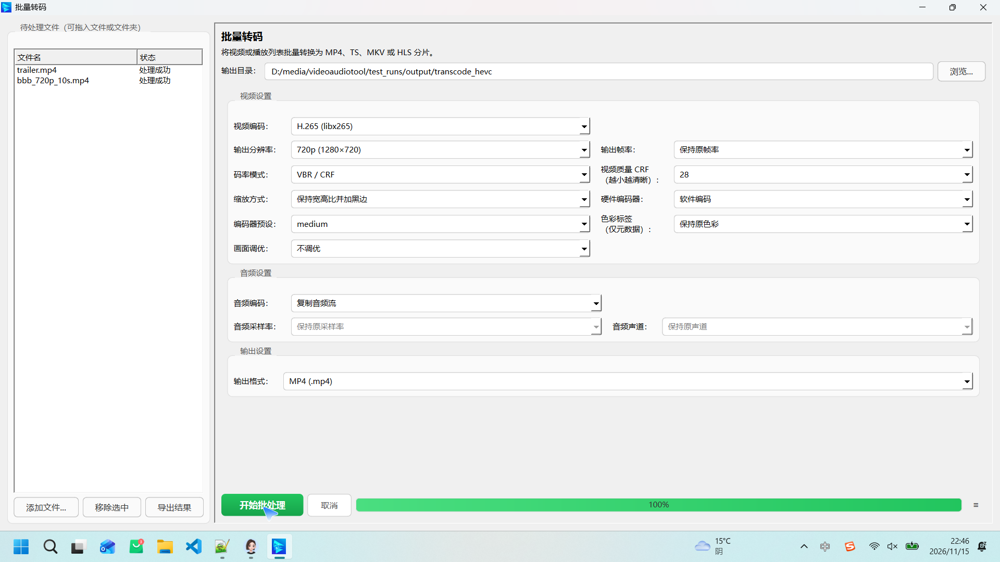
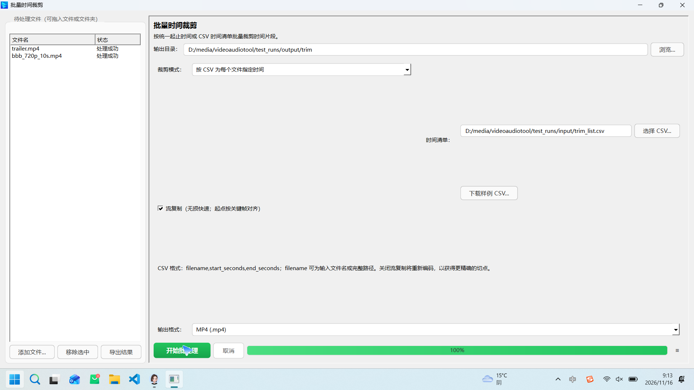
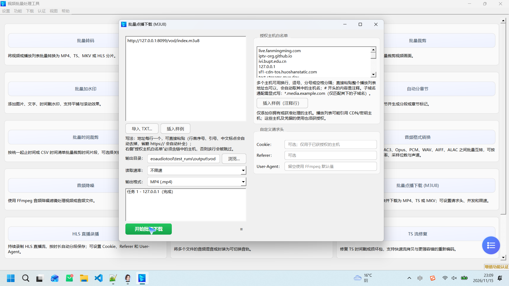

# VideoBatchTool — User Manual (Technical Edition)

> A complete guide to the product through FFmpeg, TSDuck and M3U8. Applies to the portable release build of 13 November 2026, shipped with FFmpeg 8.1.2-full and TSDuck 3.45-4798.

Subtitle: a complete guide to the product through FFmpeg, TSDuck and M3U8.

Intended subject: the portable release VideoBatchTool.exe (13 November 2026 build, 4558848 bytes). Bundled components: FFmpeg 8.1.2-full_build (gyan.dev), TSDuck 3.45-4798, N_m3u8DL-RE, and the RNNoise denoise models.

Issued 16 November 2026. The feature scope, interface wording and command-line examples in this manual are taken from that build's source and from real run logs; nothing here is inferred.

# 1 About This Manual

## 1.1 What Problem It Solves

VideoBatchTool exists to wrap FFmpeg's command-line capability inside an interface that can run batches. Every switch in the interface eventually becomes an ffmpeg or tsp command. This manual is therefore not a button reference: each section gives three things together, how to click it, what command actually runs afterwards, and why the parameters are chosen that way. Once you hold that mapping, a requirement the interface does not cover can be handled by copying a command out of the log, changing its parameters, and running it yourself.

## 1.2 Readers and Reading Paths

On first use, read Chapter 2 to prepare components and licensing, then Chapter 3 to understand the task model and where logs live, then jump straight to Chapter 5 for the feature you need.

If you transcode, cut, subtitle or process audio, focus on the first half of Chapter 4 (the FFmpeg command skeleton) and on the parameter mapping for the twelve batch features in Chapter 5.

If you handle HLS downloads, live recording or TS stream repair, focus on the second half of Chapter 4 (M3U8 playlists and the TSDuck skeleton), Chapter 6 and Chapter 7.

## 1.3 Terminology

Table 1 Terms used throughout this manual

| Term | Meaning | Where it appears |
| --- | --- | --- |
| FFmpeg | Open-source audio/video framework; all transcoding, filtering and muxing in this product is performed by it | Throughout |
| M3U8 / HLS | HTTP-based segmented streaming protocol; the playlist file carries the .m3u8 extension and media is cut into .ts segments | 4.5, Chapter 6 |
| TS | MPEG-2 Transport Stream, a bitstream packed in 188-byte packets, the standard carrier for broadcast and live delivery | Chapter 7 |
| PID | The 13-bit stream identifier in the TS packet header, separating video, audio, PAT, PMT and so on | Chapter 7 |
| PCR / PTS / DTS | Programme clock reference, presentation timestamp, decode timestamp; together they let a player align picture and sound | Chapter 7 |
| CC | continuity_counter, the packet sequence for one PID, cycling 0 to 15; a break in the sequence means a lost packet | Chapter 7 |
| CRF | Constant-rate-factor encoding parameter; lower values mean better quality and larger files | 5.1 |
| LUFS | Loudness unit; streaming platforms generally ask for about -14 LUFS | 5.11 |
| TSDuck | Open-source tool set for TS analysis, repair and injection; used here for continuity counters and PSI/SI repair | 4.4, 7.4 |
| tsp | The TSDuck main program, which processes bitstreams through chains of plugins | 4.4, 7.4 |

# 2 Runtime and Component Preparation

## 2.1 Portable Directory Layout

The portable package runs as soon as it is unpacked; no installation is needed. Components are found at fixed relative positions, and placing one in the wrong place leads directly to the FFmpeg-not-found message.

Table 2 Responsibilities of the portable package folders

| Path | Contents | Required |
| --- | --- | --- |
| VideoBatchTool.exe | Main program; set the working directory to its own folder | Required |
| lib\ffmpeg.exe | FFmpeg main program, 8.1.2-full; all transcoding, filtering and muxing depend on it | Required |
| tsduck\ | Complete TSDuck 3.45 directory with tsp.exe, tscore.dll, tsfclean.exe, tsftrunc.exe and tsplugin_*.dll | Advanced TS repair only |
| N_m3u8DL-RE.exe | External HLS downloader, used only when the download engine is switched to it | Optional |
| rnnn\ | RNNoise denoise model files | AI denoise only |
| Logs\cmd.log | Command audit log, rolled to cmd.log.1 past 8 MB | Created automatically |
| report\ | Per-round reports from scheduled tasks, numbered 1.txt, 2.txt and upwards | Created by scheduled tasks |

## 2.2 Verifying the Components

Before first use, confirm the version of all three components in a command prompt, so a truncated third-party package never catches you out.

```text
lib\ffmpeg.exe -version
   expected first line: ffmpeg version 8.1.2-full_build-www.gyan.dev

tsduck\tsp.exe --version
   expected output contains: TSDuck 3.45 (file version 3.45-4798)

dir tsduck\tsplugin_continuity.dll
   this plugin is what counter repair depends on; without it the step cannot start
```

If FFmpeg is reported missing, open Settings → Program Settings and point FFmpeg Directory at the folder containing ffmpeg.exe; the folder is validated on save and must actually hold the executable.

## 2.3 Program Settings

Table 3 Settings that change how work is executed

| Group | Setting | Value and effect |
| --- | --- | --- |
| FFmpeg | FFmpeg directory | Empty means the program folder; validated on save and refused if wrong |
| TSDuck | TSDuck directory | Must contain tsp.exe, tscore.dll and tsplugin_continuity.dll; when empty the search order is program folder tsduck\ → system install location → PATH |
| Interface | Follow system / English / Simplified Chinese | Restart is prompted after saving |
| Streaming | Stream download engine | Native FFmpeg HLS (recommended) / QtConcurrent segments (VOD only) / N_m3u8DL-RE (external) |
| Streaming | Segment download threads | 1 to 32; concurrent segments in QtConcurrent mode, and the global thread-pool ceiling |
| Threads | Batch concurrent tasks | 1 to 16; one process per file, so 1 means sequential |
| Threads | FFmpeg threads per task | 0 to 64; 0 leaves the decision to FFmpeg |
| Advanced | Enable user-owned encrypted stream support | Standard HLS AES-128 only; ticking it confirms you hold the rights |

The product of concurrency and threads per process may not exceed the machine's logical cores. Beyond that the settings page highlights the fields and disables OK, and the limit is checked again on save. The reason is plain: each file is a separate process, and too many threads fight over cores so real throughput falls.

## 2.4 Licensing and Feature Tiers

Licensing runs through Authentication → SN Authentication, with channel options of automatic detection, official site, LemonSqueezy and self-hosted server. The LemonSqueezy channel validates the licence key directly and registers the seat against this machine's identifier; signing out releases the seat online. On success a message reports the resulting tier, which decides the available entries and the file limit.

Table 4 Capability boundaries of the four tiers

| Tier | Scope | File limit |
| --- | --- | --- |
| Unactivated | All nine free batch features; three trials each for Standard and Value features within a 15-day trial period | 5 files per batch |
| Standard | Adds audio denoise, loudness normalise, stream download, live recording, unlimited use | Unlimited |
| Value | Adds track merge, TS repair, pipeline, scheduled tasks and every sub-feature Value item | Unlimited |
| Enterprise | Adds distributed cluster scheduling on top of Value | Unlimited |

Sub-feature gating refers to individual switches inside a feature, such as the hardware encoder, automatic black-bar detection, combined watermarking, two-pass normalisation and custom request headers. Each of those is counted separately for three trials, and turning one off leaves the feature itself fully usable.

# 3 Interface and Task Model

## 3.1 Home-Screen Entries

The main window menu bar reads Settings, Function, Download, Authentication, View, Help, with the grid of feature cards below it. Cards are ordered free, Standard, Value; cards above your tier carry greyed hints and open into a guidance prompt.

Table 5 The seventeen entries and what executes them

| Entry | What it does | Tier | Executed by |
| --- | --- | --- | --- |
| Batch Transcode | Transcoding, compression, scaling, container change, HLS segments | Free | ffmpeg |
| Batch Frame Extract | Nine extraction modes producing stills | Free | ffmpeg |
| Batch Crop | Manual pixel cropping, automatic black-bar detection | Free | ffmpeg |
| Batch Watermark | Image, text and timestamp, including tiling and scrolling | Free | ffmpeg |
| Hard Subtitle Burn | SRT/ASS rendered into the picture | Free | ffmpeg |
| Auto Chapters | Split at pauses, at fixed lengths, or by a marker file | Free | ffmpeg |
| Batch Time Trim | One range for all, or per-file ranges from a CSV | Free | ffmpeg |
| Batch Demux | Export raw streams by type | Free | ffmpeg |
| Audio Format Convert | First audio track to MP3/AAC/FLAC and six more | Free | ffmpeg |
| Audio Denoise | Afftdn and Anlmdn algorithms | Standard | ffmpeg |
| Loudness Normalise | LUFS normalisation or peak limiting | Standard | ffmpeg |
| Track Merge | Concatenate, mix, multi-track mux | Value | ffmpeg |
| Stream Download M3U8 | Bulk HLS vod download | Standard | ffmpeg or N_m3u8DL-RE |
| HLS Live Recorder | Background live recording, optionally segmented | Standard | ffmpeg |
| TS Stream Repair | Four strategies plus TSDuck advanced repair | Value | ffmpeg, tsp |
| Pipeline | Several processing steps chained automatically | Value | ffmpeg |
| Scheduled Tasks | Process new files in a folder on a cycle | Value | ffmpeg |

## 3.2 The Common Batch Workflow

The twelve batch windows share one skeleton: pending files on the left, parameters on the right, output directory and control buttons along the bottom. Any batch is done in these seven steps.

1. Click the light-blue title row of the card on the home screen, or use the Function menu, to open the window. At the default size the bottom buttons can be clipped, so maximise first.
2. Click Add Files and paste an absolute path into the file-name field of the dialog; separate several with spaces and wrap the set in quotes.
3. Set parameters. Prefer the keyboard for combo boxes: open the list, position with the arrow keys, confirm with Enter; mouse selection occasionally fails.
4. Specify the output directory. It is a shared long-lived setting, so a new window inherits the previous one and every feature needs confirming.
5. Click Start Batch. The status column shows waiting, processing, then success or failure, and the progress bar advances per file.
6. While running, Cancel terminates the current process; New Task does not end the current batch, it only frees the interface for configuring the next one.
7. Judge the result by the files in the output directory: on a repeated run the status column may carry over the previous run's Completed.

## 3.3 Pre-Flight Checks

Before a batch starts the program validates it, and any single hit stops the run with a stated reason. When a dialog appears, fix what it says rather than pressing Start again.

- No files added: "please add at least one media file or playlist".
- The output directory does not exist or is not writable.
- ffmpeg.exe cannot be found.
- An input file is zero bytes; the program lists the specific files, and such files cannot possibly decode.
- A feature other than Batch Transcode received an m3u8 or mpd playlist, since playlist input exists only there.
- A feature other than Batch Transcode chose HLS segment output, which exists only there.
- Parameter validation failed: crop pixels all zero, a watermark image that does not exist, a CSV that does not cover an input file.

## 3.4 Naming and Directory Rules

All features follow one naming rule: output keeps the input name with a different suffix, so results trace back to their source. When a batch contains identical base names, an eight-character path hash is appended so nothing overwrites anything else.

```text
<source base name>_<feature suffix>.<output extension>

trailer_transcoded.mp4      transcode
trailer_cropped.mp4         crop
trailer_watermarked.mp4     watermark
trailer_subtitled.mp4       hard subtitles
trailer_denoised.mp4        denoise
trailer_normalized.mp4      normalise
trailer_trimmed.mp4         time trim
trailer_repaired.mkv        TS repair
trailer_audio.flac          audio format
trailer_frames/             frame folder, holding trailer_000001.png and upwards
trailer_chapter_000.mp4     chapter segment
```

Note that running the same feature twice into the same directory overwrites the earlier output; to keep results from different batches, specify a different output directory each time.

## 3.5 Task Center and Log Window

The floating round button in the lower-right corner shows the running task count and opens the Task Center. The current-tasks page lists number, feature, operation, files, status, progress, start and finish times and duration; the history page keeps the last 200 entries within 7 days. Unactivated copies run every task serially; once activated, tasks with non-overlapping files run in parallel, while a task touching the same input file as another queues until the earlier one ends.

Output from all processes goes to the dedicated log window (View → Log Window), while each command's full command line, exit code and duration is written separately to Logs\cmd.log. That file is your first-hand evidence when troubleshooting.

```text
[2026-11-15 22:41:47.561] #1 RUN  cwd=publish lib/ffmpeg.exe -hide_banner -y -threads 2 ...
[2026-11-15 22:41:49.259] #1 END  done exit=0 (1698 ms) ffmpeg.exe
```

The RUN line is the command actually executed, including the working directory and properly quoted arguments, and can be copied into a command prompt to reproduce the run. The END line reports done for a normal finish, cancelled for a user cancellation, and failed when the process could not start; the sequence number #1 pairs the two lines. The number after exit is the process exit code, and anything non-zero is an anomaly.

# 4 Reading the Command Line: FFmpeg and TSDuck Basics

## 4.1 The FFmpeg Command Skeleton

Every command this product generates follows one skeleton: input, mapping, encoding, output. Learn those four parts and any line in the log becomes readable.

```text
ffmpeg -hide_banner -y -threads 2 -i <input path> \
       -map 0:v? -map 0:a? \
       -c:v libx264 -crf 23 -preset medium -c:a aac -b:a 192k \
       -movflags +faststart <output path>.mp4

-hide_banner  hide build info        -y  overwrite an existing output
-threads 2    threads per process    -i  input (stream URLs work the same way)
-map 0:v?     take the first video stream; the question mark tolerates absence
-c:v / -c:a   video and audio codec; copy means no re-encoding
-movflags +faststart  move the index to the front so playback can start while downloading
```

## 4.2 What the Common Parameters Mean

Table 6 Parameters that appear most often

| Parameter | Effect | Suggested value |
| --- | --- | --- |
| -c copy | Stream copy: no decode, no encode; fastest and lossless | First choice for container changes and pure cuts |
| -crf | Constant quality; lower is sharper | 18 to 23 for x264; 23 to 28 for x265; 24 to 32 for AV1 |
| -preset | Trade-off between speed and compression | medium or slow for offline batches; veryfast when speed matters |
| -b:v / -maxrate / -bufsize | The fixed-bitrate trio | For CBR, maxrate equals b:v and bufsize is twice b:v |
| -ss / -t | Start time and duration | -ss before -i seeks by keyframe and is fast; after -i is frame-accurate but slow |
| -vn / -an | Drop video or audio | -vn for audio-only work, -an for video-only work |
| -map 0:a:0 | Take audio track 0 only | Use it when a multi-track file should keep only the first track |
| -f | Force the output container | -f h264 for a raw stream, -f adts for raw AAC, -f segment for segments, -f null for no output |
| -f null NUL | Analyse only, produce nothing | Pair it with detection filters such as silencedetect and cropdetect |
| -movflags +faststart | Index at the front | Added to every MP4 output by default; required for web playback |

## 4.3 Filters and filter_complex

A single input with a single operation is served by -vf or -af. Several inputs, or a chain that must reference frame dimensions or branch into multiple outputs, needs -filter_complex, which separates chains with semicolons and names intermediate results in square brackets. Watermarking, track merging and scene-based frame extraction all use filter_complex here.

```text
# Single-input filter: scale to 720p keeping the aspect ratio, then pad
-vf "scale=1280:720:force_original_aspect_ratio=decrease:force_divisible_by=2,
     pad=1280:720:(ow-iw)/2:(oh-ih)/2,setsar=1"

# Two-input composite: scale the watermark to 25 percent of the frame width, place it bottom right
-filter_complex "[1:v][0:v]scale2ref=w=trunc(main_w*25/100/2)*2:h=-2[wmraw];
                  [wmraw]format=rgba,colorchannelmixer=aa=1.00[wm];
                  [base][wm]overlay=x=main_w-overlay_w-20:y=main_h-overlay_h-20[outv]"
  -map "[outv]" -map 0:a?
```

In the second block main_w is the width of the base picture being overlaid and overlay_w is the watermark's own width, so the x and y expressions mean "20 pixels from the right and bottom edges". Understanding that is enough to adjust watermark margins and positions yourself.

## 4.4 The TSDuck Command Skeleton

The TSDuck main program tsp works as input plugin, chain of processing plugins, output plugin. One command can string several operations onto a single pipeline, so the bitstream passes through memory once instead of being written and re-read repeatedly.

```text
tsp -I file <input.ts> -P <plugin1> --<option> -P <plugin2> --<option> -O file <output.ts>

-I file       file input plugin; add --byte-offset to skip junk at the head, --format m2ts for 192-byte packets
-P continuity --fix   continuity counter repair, equivalent to tsfixcc
-P filter --valid     drop invalid packets whose transport error flag is set
-P pcredit --add-pcr 1.5   add 1.5 seconds to all PCR, to realign clocks after splicing
-P regulate --bitrate 4000000   regulate the output bitrate to the given value
-O file <output.ts>   file output plugin
```

Advanced TS repair in this product is this plugin chain made visible: ticking a step inserts the corresponding -P plugin, the parameter area is the plugin's options, and the additional-arguments box forwards raw options the interface does not expose.

## 4.5 M3U8 Playlists and HLS Essentials

HLS cuts media into short segments, usually 2 to 10 seconds of .ts, then lists them in order in a plain-text .m3u8 playlist. Because the playlist is plain text that Notepad can open, troubleshooting follows a fixed order: read the playlist first, and only then suspect the network.

Table 7 Key tags in an M3U8 playlist

| Tag | Meaning | What it means for this product |
| --- | --- | --- |
| #EXTM3U | File header, must be the first line | Its absence means the file is not an M3U8 playlist |
| #EXT-X-VERSION | Protocol version | Decides which features are legal; live playlists usually carry 3 |
| #EXT-X-TARGETDURATION | Upper bound on segment duration in seconds | Decides player buffering and segment granularity |
| #EXTINF | Duration of the segment that follows | More segments mean a longer playlist and more requests |
| #EXT-X-ENDLIST | End-of-playlist marker | Present means vod, so the total duration is knowable; absent means the playlist keeps growing, i.e. live or EVENT |
| #EXT-X-PLAYLIST-TYPE | EVENT or VOD | EVENT may be appended to but not trimmed, common for live-then-vod |
| #EXT-X-MEDIA-SEQUENCE | Sequence number of the first segment | On a live sliding window the number advances |
| #EXT-X-STREAM-INF | Variant declaration in a multi-bitrate master, carrying BANDWIDTH | Drives the recording-variant list; auto takes the highest bandwidth |
| #EXT-X-KEY | Encryption declaration; METHOD AES-128 carries a key URI | Requires a key; only AES-128 is supported here, and only when explicitly enabled |

```text
# VOD playlist (has the end marker, so the total duration is 12 seconds)
#EXTM3U
#EXT-X-VERSION:3
#EXT-X-TARGETDURATION:4
#EXT-X-MEDIA-SEQUENCE:0
#EXTINF:4.000,
seg000.ts
#EXTINF:4.000,
seg001.ts
#EXTINF:4.000,
seg002.ts
#EXT-X-ENDLIST

# Live playlist (no end marker, appended continuously)
#EXTM3U
#EXT-X-VERSION:3
#EXT-X-TARGETDURATION:2
#EXT-X-MEDIA-SEQUENCE:0
#EXTINF:2.000,
seg000.ts
#EXTINF:2.000,
seg001.ts
... further segments are written as recording continues
```

# 5 Feature-by-Feature Operation

This chapter covers the twelve batch features in home-screen order. Each section has the same shape: one sentence on when the feature applies, the steps and key parameters, the real command the feature produced, and finally the technical points and common failures. The command examples come from measured logs, with paths shortened.

## 5.1 Batch Transcode

For container changes, bitrate reduction, resolution changes and codec changes. The two commonest uses are "container only, no re-encode" (seconds to finish, no quality loss) and "re-encode to shrink".

1. Open the window, maximise it, and add the files.
2. Choose the video codec. For a lossless container change pick Copy Video Stream; resolution, frame rate and preset are then disabled automatically.
3. Choose the audio codec, Copy Audio Stream by default; pick AAC when audio must be unified.
4. As needed, set the output resolution, scaling mode, rate-control mode and CRF, encoder preset, frame rate and colour tag.
5. Choose MP4, MPEG-TS or Matroska output; for HLS distribution choose HLS Segments.
6. Specify the output directory and start the batch.

Table 8 Key parameters of Batch Transcode

| Parameter | Values | Default | Notes |
| --- | --- | --- | --- |
| Video codec | H.264 / H.265 / VP8 / VP9 / AV1 / Copy video stream | Copy | Copy skips decoding and is fastest |
| Audio codec | AAC / MP3 / Opus / AC3 / Copy audio stream | Copy | Copy preserves the original audio |
| Output resolution | Keep / 2160p / 1080p / 720p / 480p / 360p / Custom | Keep | Custom ranges 2 to 8192 and snaps to even numbers |
| Scaling mode | Pad / Crop / Stretch | Pad | Padding loses no picture |
| Rate control | VBR (CRF) / CBR | VBR | CRF favours quality, CBR makes size predictable |
| CRF | Per-encoder range | x264 23; x265 28; AV1 28; VP9 30 | Lower is sharper and larger |
| Encoder preset | ultrafast to placebo; 0 to 8 for VP8/VP9; 0 to 11 for AV1 | medium | Slower means better compression |
| Hardware encoder | Software / NVIDIA NVENC / AMD AMF / Intel QSV | Software | Value switch, mapped from the original codec |
| Output frame rate | Keep / 24 / 25 / 30 / 60 | Keep | Changing it reflows timestamps |
| HLS segment duration | 1 to 3600 s | 6 | Visible only with HLS output |

Measured command 1: a stream-copy container change. A 52-second clip finished in under two seconds with byte-identical codecs.

```text
ffmpeg -hide_banner -y -threads 2 -i trailer.mp4 \
  -map 0:v? -map 0:a? -c:v copy -c:a copy -movflags +faststart \
  trailer_transcoded.mp4
```

Measured command 2: HEVC at 720p. Note that scaling and padding are merged into one -vf chain, the pad dimensions match scale, and setsar normalises the pixel aspect ratio so non-square pixels do not distort playback.

```text
ffmpeg -hide_banner -y -threads 2 -i trailer.mp4 \
  -map 0:v? -map 0:a? \
  -vf "scale=1280:720:force_original_aspect_ratio=decrease:force_divisible_by=2,
       pad=1280:720:(ow-iw)/2:(oh-ih)/2,setsar=1" \
  -c:v libx265 -crf 28 -preset medium -c:a copy -movflags +faststart \
  trailer_transcoded.mp4
```



Figure 1 Task list after Batch Transcode finished

Technical points: software VBR uses -crf, CBR uses -b:v -minrate -maxrate -bufsize; NVENC uses -rc vbr -cq, AMF uses -rc cqp -qp_i -qp_p, QSV uses -global_quality. With Copy Video Stream every picture parameter is disabled, because a copy never passes through a decoder and cannot alter the picture.

Common failures: a CRF outside the encoder's range (51 for x265, say) is clamped into the legal range; a hardware encoder fails immediately when the matching GPU driver is absent, with nvenc or qsv error lines in the log, at which point switching back to software encoding is enough.

## 5.2 Batch Frame Extract

For cover candidates, visual review and building an index. Of the nine modes, the fixed time interval and keyframes-only modes are the workhorses.

1. Open the window and add the video files.
2. Choose the extraction mode. Fixed interval is the general one; keyframes only is fastest and suits quick browsing; scene change finds cut points.
3. Fill in the interval, count or threshold the mode needs: seconds for interval mode, a threshold for scene mode, an interval length for thumbnail mode.
4. Choose the image format and quality, and tick Resize to a specific resolution when needed.
5. Specify the output directory and start. Output lands in a subfolder named after the source file.

```text
ffmpeg -hide_banner -y -threads 2 -i trailer.mp4 \
  -vf fps=1/1.000 -compression_level 1 -vsync 0 \
  trailer_frames/trailer_%06d.png
```

Technical points: in interval mode the denominator of fps is the interval in seconds, so 1/1.000 means one frame per second; -vsync 0 makes output frame numbers follow time strictly instead of duplicating frames; for PNG the quality parameter maps to compression level, and higher levels give smaller files at the cost of time.

Common failures: All Frames asks for a second confirmation, because 52 seconds at 24 fps yields roughly twelve hundred images and long material can reach tens of thousands; a full output directory surfaces as a write error part-way through.

## 5.3 Batch Crop

For removing bars around the picture, keeping a region, or changing the aspect ratio. Two modes: manual pixels, and automatic black-bar detection (the latter a Value switch).

1. Open the window and add the video files.
2. Choose the crop mode. Manual mode takes a pixel count per edge; automatic mode just starts.
3. In manual mode at least one edge must be greater than zero, otherwise the start is blocked.
4. Specify the output directory and start.

```text
# Manual: 200 pixels from the right, 100 from the bottom
ffmpeg -hide_banner -y -threads 2 -i trailer.mp4 \
  -map 0:v:0 -map 0:a? \
  -vf "crop=trunc((iw-0-200)/2)*2:trunc((ih-0-100)/2)*2:0:0" \
  -c:v libx264 -c:a aac -movflags +faststart trailer_cropped.mp4

# Automatic: detect the bars first, then crop to the detected area
ffmpeg -hide_banner -i trailer.mp4 -vf cropdetect=limit=0.094:round=2 -f null NUL
```

Technical points: the four crop parameters are output width, output height, horizontal origin and vertical origin. trunc with a multiple of 2 keeps both dimensions even, because H.264's yuv420p requires divisibility by 2 and odd sizes fail outright. Subtracting 200 from 854 leaves 654, which is exactly the 654x380 measured output.

Common failures: cropping more than the frame contains reports Invalid too big or non positive size; automatic detection on flat or bar-free material returns something close to the original size, which is correct.

## 5.4 Batch Watermark

For ownership marks, channel signatures and timestamped evidence. Supports seven combinations of image, text and timestamp elements; combined watermarks, full-frame tiling and scrolling motion are Value switches.

1. Open the window and add the video files.
2. Choose the watermark type. Image only needs one transparent PNG and is the most stable result.
3. Enter the watermark width as a percentage of the frame width, the opacity and the position. Multi-element types give each element its own position list.
4. Text and timestamp also need a font file, size, colour and outline width.
5. Specify the output directory and start.

```text
ffmpeg -hide_banner -y -threads 2 -i trailer.mp4 -i watermark.png \
  -filter_complex "[1:v][0:v]scale2ref=w=trunc(main_w*25/100/2)*2:h=-2[wmraw];
       [wmraw]format=rgba,colorchannelmixer=aa=1.00[wm];
       [base][wm]overlay=x=main_w-overlay_w-20:y=main_h-overlay_h-20[stg0];
       [stg0]null[outv]" \
  -map "[outv]" -map 0:a? -c:v libx264 -c:a aac -movflags +faststart \
  trailer_watermarked.mp4
```

Technical points: scale2ref scales the watermark against the real width of the main picture, so one image serves material of any resolution without distortion; aa in colorchannelmixer is the opacity; the overlay x and y expressions read "main size minus watermark size, then twenty pixels", and all nine position entries are variants of that expression.

Common failures: an empty or corrupt image path blocks the start; a malformed colour reports an invalid watermark text colour; an unreadable font file reports that the font cannot be copied, and switching to a system font fixes it.

## 5.5 Hard Subtitle Burn

Renders subtitles into the picture, for platforms that reject sidecar files or where the text must resist tampering. SRT and ASS are supported, and because burning must re-encode, libx264 with AAC is fixed.

1. Open the window and add the video files. The list shows the subtitle match for each row.
2. Choose the subtitle source mode. Same-name auto match is least work; one subtitle for all suits a shared intro; per-file binding is the most flexible.
3. Set the size, font, colour, outline width and bottom margin.
4. When the subtitle file carries full styling, tick Keep Styles From File (a Value switch); interface font settings then no longer override it.
5. Specify the output directory and start.

```text
ffmpeg -hide_banner -y -threads 2 -i trailer.mp4 \
  -vf "subtitles=filename='C\:/Temp/captions_trailer.srt':
       force_style='FontName=Arial,FontSize=24,PrimaryColour=&H00FFFFFF,
       OutlineColour=&H00000000,Outline=2,MarginV=24'" \
  -map 0:v:0 -map 0:a? -c:v libx264 -c:a aac -movflags +faststart \
  trailer_subtitled.mp4
```

Technical points: the colon inside the subtitles filter must be escaped as \: or it is read as a parameter separator; colours use the ASS &HAABBGGRR form, so the order is blue-green-red rather than the usual red-green-blue; MarginV is the bottom margin. The program copies the subtitle into a temp directory before burning, so parallel runs do not overwrite each other.

Common failures: a subtitle that is not SRT or ASS is refused; in per-file mode one unbound row blocks the start; when no same-name subtitle exists in the output directory the search falls back to the video's own folder, and failing that the file is marked failed and skipped.

## 5.6 Auto Chapters

Cuts a long video at pauses, at fixed durations, or at an existing time list, or writes chapters into the container metadata. Suits recorded courses, interviews and podcast video.

1. Open the window and add the video files.
2. Choose the output style. Splitting at pauses follows the content; fixed duration is the least fiddly; a marker file reuses an existing timeline.
3. In silence mode set the threshold and the minimum silence; the more negative the threshold, the stricter.
4. Tick Generate Chapter CSV Index and Re-encode When Splitting as needed; the latter gives more accurate cut points at the cost of re-encoding the whole file.
5. Specify the output directory and format, then start.

```text
# Step one: detect silence only, produce nothing
ffmpeg -hide_banner -nostats -i trailer.mp4 -vn \
  -af silencedetect=noise=-35.0dB:d=1.5 -f null NUL

# Step two: split at the detected points, stream copy
ffmpeg -hide_banner -y -i trailer.mp4 -segment_times 1.651 \
  -map 0 -c copy -f segment -segment_format mp4 -reset_timestamps 1 \
  trailer_chapter_%03d.mp4
```

Technical points: the silence_end values from silencedetect are the cut points; a threshold of -35 dB with a 1.5-second minimum means only quiet stretches longer than 1.5 seconds count, so material with continuous music yields very few points, and the answer is to relax the threshold towards -45 dB or shorten the minimum. Stream-copy splitting can only cut on keyframes, so exact boundaries require ticking re-encode.

Common failures: MKV with chapter marks cannot be chosen when the output format is TS; without an audio track neither silence mode nor metadata mode is available; cut points closer than 0.5 seconds cause the later one to be dropped.

## 5.7 Batch Time Trim

Cuts segments by time, in two modes: one range for all files, or per-file ranges from a CSV. Suits bulking out intros and trimming tails.

1. Open the window and add the files.
2. Choose the mode. Uniform mode takes start and end seconds; CSV mode imports a list.
3. In CSV mode, Download Sample CSV gives the template with file name, start second, end second.
4. Confirm the Stream Copy setting. Ticking it is lossless and fast but snaps the start to a keyframe; clearing it re-encodes for an exact cut.
5. Specify the output directory and start.

```text
# Uniform: start at 5 seconds, run for 10 seconds, stream copy
ffmpeg -hide_banner -y -ss 5.000 -threads 2 -i trailer.mp4 -t 10.000 \
  -map 0:v? -map 0:a? -c copy -movflags +faststart trailer_trimmed.mp4

# CSV mode: first row 2 to 6 seconds, second row 0 to 4 seconds
ffmpeg -hide_banner -y -ss 2.000 -threads 2 -i trailer.mp4 -t 4.000 ...
ffmpeg -hide_banner -y -ss 0.000 -threads 2 -i bbb_720p_10s.mp4 -t 4.000 ...
```



Figure 2 CSV time trimming, both files processed over their own ranges

Technical points: with -ss before -i the decoder seeks straight to the keyframe nearest the target, so the start drifts by a few tenths of a second; after -i it decodes frame by frame to the exact time, accurate but slower. This product uses the leading form in stream-copy mode for speed, which is why a 2-to-6 second range measured 4.08 seconds, the extra 0.08 being keyframe alignment overflow.

Common failures: a CSV that does not cover an input reports a missing input file; a repeated input is an error; a name matching several inputs must be replaced with a full path; an end time not later than the start is refused.

## 5.8 Batch Demux

Splits video, audio and subtitles out in their original compressed formats without any re-encoding, for handing to downstream tools or archiving source elements.

1. Open the window and add the files.
2. Choose the mode: video only, audio only, subtitles only, or video plus audio, optionally plus subtitles.
3. Specify the output directory and start. The program probes the stream layout first, then splits stream by stream.

```text
# Step one: probe the stream layout, produce nothing
ffmpeg -hide_banner -nostats -i trailer.mp4 -map 0 -c copy -t 0 -f null NUL

# Step two: export each stream as a raw stream
ffmpeg -hide_banner -y -i trailer.mp4 \
  -map 0:0 -c copy -f h264 trailer_video.h264 \
  -map 0:1 -c copy -f adts trailer_audio.aac
```

Technical points: the extension is the stream's original format, which is why exporting video as h264 and audio as aac requires forcing -f h264 and -f adts, since FFmpeg otherwise has nothing to infer from. Uncovered codecs have a fallback: video goes to mkv and audio to mka, still as stream copies.

Common failures: a mode whose stream does not exist reports that no target stream was found, as when subtitles-only is chosen for material without a subtitle track; cover art is ignored and does not count as a stream.

## 5.9 Audio Format Conversion

Converts the audio track of any media file to one of nine audio formats, for podcast platforms, audio libraries or uniform archiving.

1. Open the window and add files; video files can be added directly and the track is extracted.
2. Choose the output format and rate-control mode. Lossless formats hide the bitrate options.
3. Set the quality or compression level, sample rate and channel count as needed.
4. Specify the output directory and start.

```text
ffmpeg -hide_banner -y -threads 2 -i audio_test.mp3 -vn -map 0:a:0 \
  -c:a flac -compression_level 4 audio_test_audio.flac

ffmpeg -hide_banner -y -i in.mp4 -vn -map 0:a:0 -c:a aac -b:a 192k \
  -movflags +faststart out.m4a
```

Table 9 Codec mapping for the nine output formats

| Format | Codec and key parameters | Use case |
| --- | --- | --- |
| MP3 | libmp3lame; VBR uses -q:a 0 to 9, level 0 the best | The most compatible distribution format |
| AAC (.m4a) | aac with faststart, commonly -b:a 192k | Apple ecosystems and web playback |
| Raw AAC (.aac) | aac with -f adts | Devices or analysers that want a raw stream |
| FLAC | flac, -compression_level 0 to 8, 8 strongest and slowest | Lossless archiving |
| AC3 | ac3, -b:a commonly 192k to 448k | Multichannel compatibility in film and TV |
| Opus | libopus with -f opus and -vbr on | Good quality at low bitrate, suited to speech |
| ALAC | alac written into m4a | Apple lossless |
| WAV | pcm_s16le | Further processing and audio analysis |
| AIFF | pcm_s24be | Professional audio interchange |

Technical points: only the first audio track is taken, so the rest of a multi-track file is not preserved; -vn explicitly drops the picture and prevents accidentally remuxing the whole video.

Common failures: APE is input only, since FFmpeg has no APE encoder, so its absence from the output list is expected; a source with no audio track fails.

## 5.10 Audio Denoise (Standard)

Removes noise floor, air-conditioning hum and electrical noise. Two algorithms: Afftdn is frequency-domain spectral subtraction with controllable parameters; Anlmdn is time-domain non-local-means, suited to steady noise.

1. Open the window and add the files.
2. Choose the algorithm and a parameter preset; Custom exposes strength, noise band and attenuation ceiling separately.
3. Tick automatic noise-floor tracking and high-frequency preservation as needed.
4. Choose the audio output format and container, set the output directory, and start.

```text
ffmpeg -hide_banner -y -threads 2 -i trailer.mp4 \
  -map 0:v? -map 0:a:0? -map 0:s? -c:s copy -c:v copy -c:a aac \
  -af afftdn=nr=29:nf=-25:bm=0.8 -movflags +faststart trailer_denoised.mp4
```

Technical points: nr is the noise reduction ceiling, and 29 was measured as strong denoising; nf is the estimated noise floor, and the closer it is to the real floor the cleaner the result; bm is the band boundary, 0.8 when high-frequency detail is preserved and 1.25 otherwise; tn=1 enables automatic floor tracking. Video streams are always copied and only audio is re-encoded, so speed depends on audio length.

Common failures: excessive denoising makes speech hollow, so start around nr 12 and increase while listening; a subtitle stream only reaches the output when the keep-subtitles option is ticked, otherwise it is dropped.

## 5.11 Loudness Normalisation (Standard)

Brings audio from different sources to one loudness or peak level, the single most worthwhile step before assembling a batch. The default LUFS mode matches EBU R128 and the recommendations of the major platforms.

1. Open the window and add the files.
2. Choose the scheme. LUFS normalisation unifies perceived loudness; Peak limiting only caps peaks without changing overall loudness.
3. Set the target loudness and true peak. -14 LUFS is usual for online video, -16 for podcasts, -23 for broadcast.
4. For higher precision tick two-pass (a Value switch); the program measures first, then applies.
5. Choose the output format and directory, then start.

```text
ffmpeg -hide_banner -y -threads 2 -i trailer.mp4 \
  -map 0:v? -c:v copy -map 0:a? -c:a aac \
  -af loudnorm=I=-16.0:TP=-1.0:LRA=11 -movflags +faststart trailer_normalized.mp4

# Two-pass: measure first, then apply with the measured values
ffmpeg -i in.mp4 -af loudnorm=I=-16:TP=-1:LRA=11:print_format=json -f null NUL
ffmpeg -i in.mp4 -af loudnorm=I=-16:TP=-1:LRA=11:\
  measured_I=-22.5:measured_TP=-3.1:measured_LRA=7.2:measured_thresh=-33 \
  -c:v copy -c:a aac out.mp4
```

Technical points: single-pass loudnorm adjusts dynamically and suits continuous material; two-pass measures the whole file and then applies linear gain, preserving dynamics better at the cost of two runs. Peak mode first uses volumedetect to find the peak, then applies a volume difference plus alimiter.

Known behaviour and advice: single-pass output raises the audio sample rate to 96 kHz as a side effect of internal resampling, so add -ar 48000 to your own template when downstream is sensitive to sample rate; setting a target far louder than the source audibly lifts the noise floor, in which case denoise before normalising.

## 5.12 Track Merge (Value)

Joins several pieces into one, mixes several audio sources into one, or muxes switchable audio tracks. Suits multi-language collections, multi-person interview assembly and combining material into a finished cut.

1. Open the window and add at least two files.
2. Choose the merge mode: sequential concatenation, mix to a single track, or mux as several switchable tracks.
3. In mix mode set the fade duration and adjust each source's level in the second column.
4. Choose the channel layout, set the output directory, and start. The whole batch runs as one task.

```text
ffmpeg -hide_banner -y -i merge_a.mp4 -i merge_b.mp4 \
  -filter_complex "[0:v:0]scale=1280:720:force_original_aspect_ratio=decrease,\
        pad=1280:720:(ow-iw)/2:(oh-ih)/2,setsar=1,setpts=PTS-STARTPTS[v0];\
      [0:a:0]aresample=48000,aformat=channel_layouts=stereo,asetpts=PTS-STARTPTS[a0];\
      [1:v:0]...same as above... [v1];[1:a:0]...same as above... [a1];\
      [v0][a0][v1][a1]concat=n=2:v=1:a=1[vout][aout]" \
  -map "[vout]" -map "[aout]" -c:v libx264 -c:a aac \
  -movflags +faststart concatenated.mp4
```

Technical points: before concatenating, every piece must agree on frame size, pixel aspect ratio, sample rate and channel layout, or concat fails or produces misaligned sound; setpts and asetpts reset timestamps to zero so the second piece does not accumulate from where the first ended. Two 52-second 720p pieces measured 104.42 seconds at 1280x720.

Common failures: fewer than two inputs is blocked; each source sits at 100 percent by default and one attenuated to zero is effectively muted; when muxing tracks the track title comes from the file name, so duplicates are hard to tell apart and should be renamed beforehand.

# 6 Streaming: M3U8 Download and Live Recording

## 6.1 Stream Download (Standard)

For saving HLS vod content in bulk. The window is split in two: addresses and controls on the left, shared configuration on the right with the host whitelist, maximum concurrency and custom request headers.

1. Enter one playlist address per line in the left pane. Pasting works directly; the program strips the BOM, leading numbering, quotes and trailing remarks.
2. Fill in the authorised host whitelist in the right pane, host names only, for example 127.0.0.1 or media.example.com; subdomain wildcards are written *.media.example.com.
3. Set the maximum concurrent tasks, the read rate (unlimited, about real time, half speed, quarter speed) and the output format.
4. For sites with hotlink protection, supply Referer, User-Agent and Cookie in the request headers.
5. Specify the output directory and click Start Batch Download.

```text
ffmpeg -hide_banner -y -f hls \
  -protocol_whitelist http,https,tcp,tls,crypto \
  -http_seekable 1 -http_persistent 1 \
  -reconnect 1 -reconnect_streamed 1 -reconnect_on_network_error 1 \
  -reconnect_on_http_error 5xx,408,429 -reconnect_delay_max 30 \
  -i http://127.0.0.1:8099/vod/index.m3u8 \
  -map 0:v? -map 0:a? -c copy -movflags +faststart hls_001_6fd7d2de.mp4
```



Figure 3 Task log after Stream Download finished

Technical points: -f hls makes FFmpeg demux the playlist as HLS instead of guessing; protocol_whitelist bounds which protocols are allowed, and AES-128 content needs crypto and https; the three reconnect options plus the 5xx, 408 and 429 error list are what carries you through CDN fluctuation and rate limiting; -c copy means segments are stitched without re-encoding.

The output name is fixed as hls_ plus a three-digit sequence plus an eight-character address hash plus the container suffix. The suffix must be a real container, because FFmpeg infers the output format from it; an invalid suffix reports Unable to choose an output format and fails with exit code -22.

Three download engines: native FFmpeg HLS handles dynamic live playlists and byte ranges; QtConcurrent segment fetching works only on vod playlists, with segment concurrency taken from the settings; N_m3u8DL-RE is the external downloader, invoked as "best video, all audio, all subtitles, remux to the chosen format" and suited to sites where tracks must be selected.

## 6.2 HLS Live Recording (Standard)

Records a live stream continuously into local files, optionally segmented by the hour. The window shares the whitelist, concurrency and request-header settings with Stream Download.

1. Enter the live playlist address; a master playlist resolves into selectable variants.
2. Choose the recording variant. Auto takes the highest bandwidth and pulls only that one, avoiding the slowdown of fetching every variant at once.
3. Choose the output format, set the recording duration limit and automatic segmentation. A duration of 0 records until stopped manually.
4. Confirm the output directory and file name, then click Start Background Recording.
5. To finish, click Stop Recording; the program asks the process to exit and only forces an end after five seconds.

```text
ffmpeg -hide_banner -n -f hls \
  -protocol_whitelist http,https,tcp,tls,crypto \
  -reconnect 1 -reconnect_streamed 1 -reconnect_delay_max 30 \
  -i http://127.0.0.1:8099/live/index.m3u8 \
  -map 0:v? -map 0:a? -c copy \
  -f segment -segment_time 3600 -reset_timestamps 1 -strftime 1 \
  -segment_format matroska <output prefix>_%Y%m%d_%H%M%S.mkv
```

Technical points: the difference between live and vod is that the playlist has no end marker, so FFmpeg keeps following its growth; -f segment with -segment_time cuts a file every hour, -strftime puts a timestamp in the name, and -reset_timestamps makes each segment start from zero, without which a player treats later segments as a continuation and cannot play them alone. Note that -n refuses to overwrite existing files, which is safer than -y in a live context.

Practical warning: this build has a path-assembly defect in the combination of a specific output directory with automatic segmentation; the log can show a drive letter rewritten into something like D_ and the process then ends with exit code -2. When you see that recording exited abnormally without producing any file, use the workaround in 10.3 and attach the command line from the log for the developers. The recording chain itself works: running the same playlist by hand with a correct path proves it.

## 6.3 Encrypted Streams and the Compliance Boundary

The program supports standard HLS AES-128 only, and only after Enable User-Owned Encrypted Stream Support is ticked under Settings → Program Settings; ticking it is taken as your confirmation that you hold the rights to fetch and process the content. Widevine, FairPlay and PlayReady are not supported at all, and nothing is bypassed.

The whitelist is a compliance constraint rather than a security measure: add only hosts you own or are authorised to handle, and note that the CDN and key servers referenced by a playlist need authorisation too. Live and vod share this one whitelist, so adding a host once applies everywhere.

## 6.4 Diagnosing Download Failures

Table 10 Common streaming failures

| Symptom | Cause | Action |
| --- | --- | --- |
| Host not authorised | The host is not on the whitelist | Add it in the right pane, or accept the one-click prompt |
| Exit code -22, Unable to choose an output format | The output file suffix is invalid | Confirm the container suffix is mp4, ts or mkv; delete leftover empty files from older builds |
| Exit code -2, ends immediately | Input or output path unusable, for example a rewritten path | Check that the path in the logged command line exists and the drive letter is complete |
| Stuck waiting | Segment URLs return 403 or need authentication | Supply Referer, User-Agent and Cookie, with no line breaks in the values |
| Interrupted part-way | CDN fluctuation or rate limiting | Keep the reconnect options, lower concurrency, or switch to half-speed reading |
| Concurrency limit reached | The maximum in the right pane is in use | Wait for a task to finish or raise the limit |
| Playlist reported as encrypted | EXT-X-KEY present and AES support off | Confirm rights and enable encrypted stream support, or switch source within your authorisation |
# 7 TS Streams and Repair

## 7.1 TS Structure Basics

TS is the standard container for broadcast and live delivery. Its design goal is that decoding can start from any point, and the price is a looser structure than MP4, where a fault anywhere shows up as blocking, stalling, lost lip-sync or a file that will not open. Understand the six ideas below and you can decide which repair strategy applies.

Table 11 Six key notions in a TS stream

| Notion | Meaning | How damage shows |
| --- | --- | --- |
| Fixed 188-byte packets | Every TS packet is exactly 188 bytes, byte 0 always the 0x47 sync byte | Junk bytes at the head shift everything, and the player cannot recognise the stream |
| PID | A 13-bit stream identifier; video, audio, PAT, PMT and PCR each take a different PID | Colliding or missing PIDs cause missing programmes, no sound or no picture |
| PCR | Programme clock reference, from which the player restores the system clock | A PCR jump freezes the player or drifts lip-sync |
| PTS / DTS | Presentation and decode timestamps | Disorder causes lost lip-sync and the picture jumping back |
| CC continuity counter | Packet sequence per PID, cycling 0 to 15 | A break means lost packets, visible as mosaic or local blocking |
| PSI/SI tables | PAT and PMT describe which programme maps to which streams | A damaged table makes the whole span unrecognisable, with duration and tracks reading zero |

## 7.2 Diagnose Before Repairing

Knowing the type of damage is the precondition for choosing a strategy. Three commands cover most situations.

```text
# 1. Can FFmpeg read a duration and track list?
ffmpeg -hide_banner -i broken.ts
   duration shows N/A or tracks are missing -> the PSI/SI tables are already broken

# 2. Is the packet structure aligned (does 0x47 recur every 188 bytes)?
publish\tsduck\tsanalyze.exe broken.ts
   the TS packet errors and continuity errors counts in the report directly show bad packets and CC gaps

# 3. Is the bitrate steady?
publish\tsduck\tsbitrate.exe broken.ts
   wide swings mean null packets have crept in or the stream is dropping out
```

The mapping from diagnosis to strategy is: timestamps alone → timestamp continuity; clear bad packets with tables still intact → drop bad packets and remux; tables or counters badly disordered → TSDuck; data so damaged it cannot be parsed → fault-tolerant re-encoding.

## 7.3 The Four Repair Strategies

The TS repair dialog is a batch tool: files on the left, strategy and output format on the right, output directory and Start button at the bottom. It accepts ts, m2ts and mts, and can export a results CSV.

Table 12 When each strategy applies

| Strategy | Command essentials | Fit and cost |
| --- | --- | --- |
| Timestamp continuity (stream copy, fast) | -fflags +genpts -dts_delta_threshold 1 -c copy -avoid_negative_ts make_zero | For timestamp jumps and negative timestamps; seconds to finish, no quality change, but no data is restored |
| Drop bad packets and remux (stream copy) | Add +discardcorrupt+igndts | For material with visible bad packets; those packets are discarded and brief stalls can appear |
| TSDuck continuity counter light repair | tsp -I file in -P continuity --fix -O file out | For CC gaps caused by segment splicing; fixes counters only and touches nothing else |
| Fault-tolerant re-encode (slow) | Add -err_detect ignore_err plus setpts and asetpts, re-encode to H.264 with AAC | For badly damaged structure whose pictures still decode; discards the original timeline and restarts timing, most reliable and slowest |

Measured command (timestamp continuity, Matroska output):

```text
ffmpeg -hide_banner -y -fflags +genpts -dts_delta_threshold 1 \
  -i ts_test.ts -map 0:v? -map 0:a? -c:v copy -c:a copy \
  -avoid_negative_ts make_zero ts_test_repaired.mkv
```

What the parameters do: +genpts regenerates timestamps when missing; dts_delta_threshold 1 treats an abnormal jump between adjacent DTS values as damage and recomputes; avoid_negative_ts make_zero shifts negative timestamps up to zero so a player does not reject a file that begins before zero. MKV is the default output because it tolerates timestamps more loosely than MP4.

## 7.4 TSDuck Advanced Repair

When the four basic strategies fall short, the TSDuck Advanced Repair button at the foot of the dialog enters plugin-level repair. It is a modal child window and can run repeatedly; the top carries presets and the current tsp directory, steps are listed on the left, that step's parameters on the right, and batch inputs, output directory and overwrite policy along the bottom.

The order of work: choose a preset or tick steps directly, tune each parameter, add files to the list, choose the output directory and overwrite policy, and start. Ticked steps are assembled in a fixed safe order regardless of the order you ticked them: sync, filter, CC, PSI/SI, PID, timestamps, bitrate.

Table 13 Capability groups in TSDuck advanced repair

| Group | Available steps | Typical command |
| --- | --- | --- |
| Packet sync and bad packets | Locate 0x47 automatically, drop invalid packets, drop a given PID, CC repair, skip head, range extraction, tsftrunc, tsfclean | -I file in --byte-offset N; -P filter --valid; -P continuity --fix |
| PID management | Identify PIDs, remap, range offset, drop orphan PIDs, drop a service, copy a PID | -P identify --log; -P remap 0x100=0x200; -P rmorphan; -P svremove |
| PSI/SI tables | Rebuild PAT/PMT, drop services, drop PIDs, change service name, XML patch, change TS ID, inject EIT | -P pat --create; -P pmt --create; -P sdt --name; -P sections --patch-xml |
| Timestamps and bitrate | Offset PCR/PTS/DTS, correct PCR against bitrate, duplicate PCR, regulate bitrate, strip null packets, insert null packets | -P pcredit --add-pcr; -P pcradjust --bitrate; -P regulate; -P reduce |
| Merging and splicing | Merge several files, inject or remove SCTE-35 | Several -I file with one -O file; -P spliceinject; -P rmsplice |
| Data injection | Inject PSI/SI or private sections, extract DSM-CC | -P inject --pid X file; -P dsmcc --output-directory |

What is deliberately absent is scrambling and raw-stream packing: descrambling needs control words or a commercial ECMG/EMMG chain, which belongs to an online environment; tspacketize packs PSI/SI tables rather than PES payloads, and converting between PES and TS should use FFmpeg instead. These capabilities never appear in the interface, so no promise is made for something that cannot be delivered.

Table 14 The eight presets

| Preset | Step combination |
| --- | --- |
| One-click deep repair | Auto align, drop TEI-invalid packets, CC repair, tsfclean, tsftrunc |
| CC continuity repair only | continuity --fix |
| Bad packet clean-up | filter --valid --stuffing, continuity --fix |
| Head junk plus tail truncation | Auto align, tsftrunc |
| PSI/SI rebuild | pat --create, pmt --create, sdt |
| Timestamp offset calibration | pcredit --add-pcr --add-pts --add-dts |
| Bitrate regulation (CBR) | regulate --bitrate |
| Bitrate reduction (strip nulls) | reduce |

Execution details: output is always .ts, named with a _tsduck suffix, and merge mode writes merged_tsduck.ts; the overwrite policy can overwrite, skip when present, or rename automatically; concurrency collapses from the setting down to the actual file count; on failure partial output is deleted by default, and Keep Partial Output On Failure preserves it for diagnosis. The post-processing tool tsfclean can exit 0 on input it cannot handle while writing an empty file, so the program checks whether the product is a multiple of 188 bytes and discards the temporary output if not, keeping the tsp result.

## 7.5 Limits of Repair

Repair makes existing data usable again; it cannot conjure back data that is gone. Lost segments, a truncated tail and packets damaged beyond decoding are beyond every tool. Keep the original file before repairing, and judge success by "it plays correctly, with the right duration and tracks" rather than by "the error count reached zero": filtering out every bad packet certainly zeroes the count, and it also removes frames.

# 8 Pipeline (Value)

A pipeline chains several processing steps so the output of one becomes the input of the next, which suits fixed recipes produced in bulk: crop, denoise, normalise, subtitle, watermark, transcode, chapter and frame extraction, configured once and reused.

## 8.1 Local File Pipeline

1. In the Pipeline window choose the Local File Pipeline tab and set the output directory.
2. Add input files. Common audio and video formats are accepted; whether a playlist works depends on the first sub-task, and usually only Batch Transcode supports it.
3. Click Add Sub-task, pick one of the twelve batch features, and configure its parameters in the page that opens.
4. Reorder with edit, delete, move up and move down; double-clicking a row also edits it.
5. Click Start Pipeline. Once validation passes the window closes and the whole chain runs as one task in the Task Center.

The rule for passing output between stages deserves separate note: the engine scans the output directory by the prefix "base name plus underscore" and feeds every product of the previous stage into the next. A single-output feature produces one file per input; a multi-output feature produces N files per input — frame extraction, demux, track merge, chapter splitting and HLS segment transcoding are all of that kind — and at that point the chain forks into N parallel sub-chains. Putting frame extraction last is therefore an effective way to bound the size of a chain.

At run time the stages are serial and each stage is parallel internally up to the batch concurrency setting; a file that fails at one stage does not continue into the next; progress advances by "input file count times sub-task count".

## 8.2 HLS Pipeline

The HLS tab folds source acquisition into the chain: download vod content or record a live stream as configured, repair TS as needed, then run the sub-task chain. Suits scheduled capture of a fixed live channel that must come out as a finished file.

Table 15 Source-stage parameters of the HLS pipeline

| Parameter | Meaning | Default |
| --- | --- | --- |
| Source type | Stream download or live recording | Stream download |
| Recording duration (s) | Needed for live only, and must exceed 0 or the chain cannot advance automatically | 300 |
| Live address | M3U8 playlist or live address; the whitelist comes from the streaming settings | Empty |
| TS repair | After acquisition, remux with fault tolerance and add a _repaired suffix | Ticked |
| Request headers | Referer, User-Agent, Cookie; a value containing a line break is ignored | Empty |
| Output directory | Shared with the other windows and remembered | User home |

The source-stage product is named "source name plus _source.ts", where the source name comes from the file name inside the address with illegal characters filtered out. In progress terms the source stage occupies the first 30 percent, of which download or recording completes at about 25 percent and repair at about 30 percent, while the sub-task chain runs from 30 to 100 percent. Stream download inside a pipeline always behaves as if AES-128 were disabled, independent of the global switch, so an encrypted playlist fails at the source stage.

## 8.3 Parameter Notes

Sub-task parameter pages reuse the real controls of each feature, so their meaning is exactly as in Chapter 5. Two points need particular care.

First, multi-output features multiply the file count of every later step; a chain containing frame extraction with tens of inputs can turn into thousands of intermediate files within minutes. Prove the parameters on a single sample before running the whole set.

Second, this build was measured to lose the start and end time of Time Trim when it runs as a pipeline sub-task, so the command degrades to start zero and duration zero and the product is a fraction of a second. The workaround is to trim in the standalone window first and feed the trimmed files into the pipeline, or to use a slicing method that does not depend on time parameters, such as Auto Chapters. The issue has been reported; once fixed, normal use resumes.

# 9 Scheduled Tasks and the Task Center

## 9.1 Creating a Scheduled Task

A scheduled task makes the program scan a folder on a cycle and process newly arrived files automatically, which suits repetitive work such as transcoding everything received at a fixed time each day.

1. Enter from the Scheduled Tasks card on the home screen and give the task a name.
2. Set the file directory (where incoming material sits) and the output directory (where products go); the two must differ.
3. Set the first start time and the repeat interval.
4. Click Add Sub-task, choose the processing step and configure its parameters, following the same rules as the pipeline.
5. Click Save. The task enters the schedule immediately and the configuration file grows with it.

Table 16 Scheduled task fields

| Field | Meaning | Note |
| --- | --- | --- |
| Task name | Identifier shown in the Task Center and reports | Duplicate names create independent tasks |
| File directory | The folder scanned | Files processed successfully move into a processed subfolder beneath it |
| Output directory | Where products go | Must not equal the file directory |
| First start time | The first trigger | When earlier than now, saving runs a round immediately |
| Repeat interval | Period between scans | Set in hours |
| Sub-task chain | Processing steps and parameters | Three sub-tasks at most on a lower tier |

Interface note: at its default size the new-task dialog sometimes ignores clicks on the bottom Save and Cancel buttons; maximise the window, or move between buttons with the keyboard and press Space.

## 9.2 Run Records and Reports

Each trigger writes a numbered text report into the report subfolder of the program directory, covering the task name, trigger time, sub-task chain, both directories, result statistics and the list of successful files.

```text
Task number: 13
Task name: AutoTest-Sched-1
Trigger time: 2026-11-16 09:05:38 (scheduled)
Sub-task chain: Audio Format Convert
File directory: D:/media/.../output/sched_in
Output directory: D:/media/.../output/sched_out
1 file processed this round: 1 succeeded, 0 failed, 0 undecided.
Succeeded: D:/media/.../sched_in/sched_test.mp3
Result: 1 succeeded, 0 failed this round. 1 file moved into the processed folder.
```

When there is nothing new the report states that the round did not run because no new files needed processing; that is a normal empty round, not a failure. To diagnose a scheduled task, look at three places together: the reports in the report folder, the commands and exit codes in cmd.log, and the file moves in the processed subfolder.

## 9.3 The Task Center

The four tabs cover current tasks, task history, scheduled tasks and scheduled history. Of the nine columns, hovering the status column shows the reason for a failure or a queue, and the file column shows only the first three paths with the full path on hover. A running task can be stopped with End Operation; a queued task's button becomes Cancel Queueing.

The scheduled-tasks tab offers Modify and Terminate: Modify keeps the processed records and run statistics and recomputes the next run from the new time, while Terminate only stops future triggers and lets the current round finish. The scheduled-history tab offers Reuse, which brings a previous definition's parameters into a new window for quick duplication. Every tab can export CSV, writing current and historical tasks together into the output directory.

# 10 Troubleshooting

## 10.1 Locating Problems With Logs

Keep to a fixed four-step order: read the failure message in the interface, open the log window and read the tail of that file's output, go back to cmd.log by sequence number for the same command, and finally re-run that command by hand. A manual re-run cleanly separates "the program built the wrong parameters" from "the material or environment is at fault".

Table 17 What the common exit codes mean

| Exit code | Usual cause | Where to look |
| --- | --- | --- |
| 0 | Normal finish | Check the product against expectations |
| 1 | Invalid parameter or broken filter chain | Read the last Error line in the log, which usually names the parameter |
| -22 | Output format cannot be inferred, or the file is not writable | Confirm the suffix matches the container and the directory exists and is writable |
| -2 | Input or output path unusable | Confirm the path is complete, the drive letter intact and the file present |
| -1073741515 | Missing runtime library, process could not start | For example tsp.exe copied alone without tscore.dll |
| cancelled | Cancelled by the user | Not a fault, though partial output may be incomplete |

## 10.2 Quick Reference for Common Problems

Table 18 Runtime problems

| Symptom | Cause | Action |
| --- | --- | --- |
| FFmpeg not found | The component directory is wrong | Point the program settings at the folder containing ffmpeg.exe |
| The following input files are empty (0 bytes) | Empty shells left by an earlier failure | Remove or replace those files |
| Operation does not support playlist input | Playlists are accepted by Batch Transcode only | Use Batch Transcode, or download to local files first |
| MPEG-TS does not support this chapter-marker mode | Chapter metadata needs MP4 or MKV | Change the output format |
| Watermark text colour invalid | Malformed colour value | Use a colour name or #RRGGBB |
| Cannot copy the watermark font file | Font path unreadable or temp folder not writable | Use a system font |
| Please choose a valid SRT/ASS subtitle for every input | An unbound row in per-file mode | Bind every row or switch to auto matching |
| No target stream found for demux | The chosen mode's stream does not exist | Choose a mode that includes a present stream |
| Total thread count exceeds core count | Concurrency times threads is over the limit | Lower concurrency or threads per process |
| Task stays queued | Unactivated serial runs, or the same file is in use | Wait for the earlier task, or cancel the queue in the Task Center |
| Sub-tasks in a chain multiply | A multi-output feature produces several files per input | Put the multi-output feature last in the chain |
| Bulk download reports Unable to choose an output format | Invalid output suffix | Confirm the container suffix and delete leftover empty files |

## 10.3 Known Issues in This Build

The five behaviours below were reproduced reliably in real testing of this build. Pass them on to anyone who will use the tool long-term, so a known defect is not mistaken for a problem with the material.

Table 19 Known issues and workarounds

| Symptom | Effect | Workaround |
| --- | --- | --- |
| Live recording output path rewritten, process ends with exit code -2 and no file | That entry is unusable in the combination of a specific output directory with automatic segmentation | Try recording with segmentation off; or run the same playlist by hand on the command line; report the logged command line to the developers |
| Time Trim inside a pipeline ignores its parameters, product only a fraction of a second | Chains that depend on a trim range produce empty shells | Trim in the standalone window first and feed the result in; or use another slicing method |
| Auto Chapters with the CSV index ticked produces no CSV | The index file is missing, though splitting itself works | Treat the segment files as authoritative and reconstruct a list from their durations |
| Loudness normalisation raises the output sample rate to 96 kHz | Downstream that is sensitive to sample rate needs a second pass | Add -ar 48000 in a later step, or use a template that locks the sample rate |
| Some dialogs ignore clicks on bottom buttons at default size | The interface seems to hang | Maximise the window; if needed move between buttons with the keyboard and press Space |

# 11 Appendices

## Appendix A Command Quick Reference

Table A.1 Command skeleton per feature

| Feature | Command skeleton |
| --- | --- |
| Batch Transcode (copy) | ffmpeg -y -i in -map 0:v? -map 0:a? -c copy -movflags +faststart out.mp4 |
| Batch Transcode (encode) | ffmpeg -y -i in -vf scale=... -c:v libx265 -crf 28 -preset medium -c:a aac out.mp4 |
| Batch Frame Extract | ffmpeg -y -i in -vf fps=1/1.000 -vsync 0 out_%06d.png |
| Batch Crop | ffmpeg -y -i in -vf crop=W:H:X:Y -c:v libx264 -c:a aac out.mp4 |
| Batch Watermark | ffmpeg -y -i in -i wm.png -filter_complex "...overlay=..." -map "[outv]" out.mp4 |
| Hard Subtitle Burn | ffmpeg -y -i in -vf "subtitles=file.srt:force_style='...'" -c:v libx264 -c:a aac out.mp4 |
| Auto Chapters | ffmpeg -y -i in -segment_times T1,T2 -map 0 -c copy -f segment out_%03d.mp4 |
| Batch Time Trim | ffmpeg -y -ss S -i in -t D -map 0:v? -map 0:a? -c copy out.mp4 |
| Batch Demux | ffmpeg -y -i in -map 0:0 -c copy -f h264 out.h264 -map 0:1 -c copy -f adts out.aac |
| Audio Format Convert | ffmpeg -y -i in -vn -map 0:a:0 -c:a flac -compression_level 4 out.flac |
| Audio Denoise | ffmpeg -y -i in -c:v copy -c:a aac -af afftdn=nr=29:nf=-25:bm=0.8 out.mp4 |
| Loudness Normalise | ffmpeg -y -i in -c:v copy -c:a aac -af loudnorm=I=-16:TP=-1:LRA=11 out.mp4 |
| Track Merge | ffmpeg -y -i a -i b -filter_complex "...concat=n=2:v=1:a=1" -map "[vout]" -map "[aout]" out.mp4 |
| Stream Download | ffmpeg -y -f hls -protocol_whitelist ... -i url.m3u8 -c copy out.mp4 |
| Live Recording | ffmpeg -n -f hls -i url.m3u8 -c copy -f segment -segment_time 3600 out_%Y%m%d_%H%M%S.mkv |
| TS Repair (basic) | ffmpeg -y -fflags +genpts -dts_delta_threshold 1 -i in.ts -c copy -avoid_negative_ts make_zero out.mkv |
| TS Repair (TSDuck) | tsp -I file in.ts -P continuity --fix -O file out.ts |

## Appendix B Recommended Parameter Values

Table B.1 Practical values for common parameters

| Situation | Suggested parameters |
| --- | --- |
| High-definition archive | x264 or x265, CRF 18 to 23, preset slow |
| Online distribution | x264, CRF 23, 720p, AAC 128k to 192k |
| Fast preview | Copy the video stream, or CRF 28 with veryfast |
| Loudness target | -14 LUFS for online video, -16 for podcasts, -23 for broadcast; true peak -1.0 to -2.0 |
| Denoise starting point | Afftdn nr 12, raised towards 29; bm 0.8 to keep high-frequency detail |
| Frame interval | 1 second for review; 5 to 10 seconds for cover candidates; scene threshold 0.3 for cut points |
| Silence splitting | Start at -35 dB with a 1.5-second minimum; relax to -45 dB for continuous music |
| HLS segments | 2 to 6 seconds for live, 6 to 10 for vod; archive in 60-minute blocks |
| TS repair | Stream copy for timestamp problems; continuity --fix for CC gaps; re-encode only when the structure has collapsed |

## Appendix C TSDuck Plugin Quick Reference

Table C.1 Repair situations and matching plugins

| Situation | Plugin and common options |
| --- | --- |
| CC gaps | -P continuity --fix |
| Drop transport-error packets | -P filter --valid |
| Skip junk at the file head | -I file in.ts --byte-offset 188 --format m2ts |
| PID remapping | -P remap 0x100=0x200; range form 0x100-0x10F=0x200 |
| Rebuild PSI/SI | -P pat --create; -P pmt --create; -P sdt --name <name> |
| Shift all timestamps | -P pcredit --add-pcr 1.5 --add-pts 1.5 --add-dts 1.5 |
| Bitrate regulation | -P regulate --bitrate 4000000 |
| Remove null packets to cut bitrate | -P reduce |
| Truncate to a given duration | -P until --seconds 600 |
| Merge several files | tsp -I file a.ts -I file b.ts -P ... -O file out.ts |

## Appendix D Where Files and Data Live

Table D.1 Locations of configuration, logs and reports

| Category | Location | Notes |
| --- | --- | --- |
| Command audit log | Logs\cmd.log in the program folder | A RUN and an END line per command; rolled to cmd.log.1 past 8 MB |
| Scheduled task reports | report\N.txt in the program folder | Numbered upwards, one per round |
| Application settings | Encrypted settings store | FFmpeg and TSDuck directories, language, threads, concurrency, whitelist and so on |
| Task history | Encrypted settings store, taskCenter/history | Up to 200 entries within 7 days, at most 100 file paths per task |
| Temporary files | System temp folder | Watermark fonts, subtitle copies, chapter metadata; cleared on exit |
| Output products | The output directory set per feature | One shared setting, preserved across restarts |

The manual ends here. To reproduce any command, copy the RUN line verbatim from Logs\cmd.log, which is closest to what actually executed; the examples here omit absolute paths for readability, so fill in input and output paths before running them.
